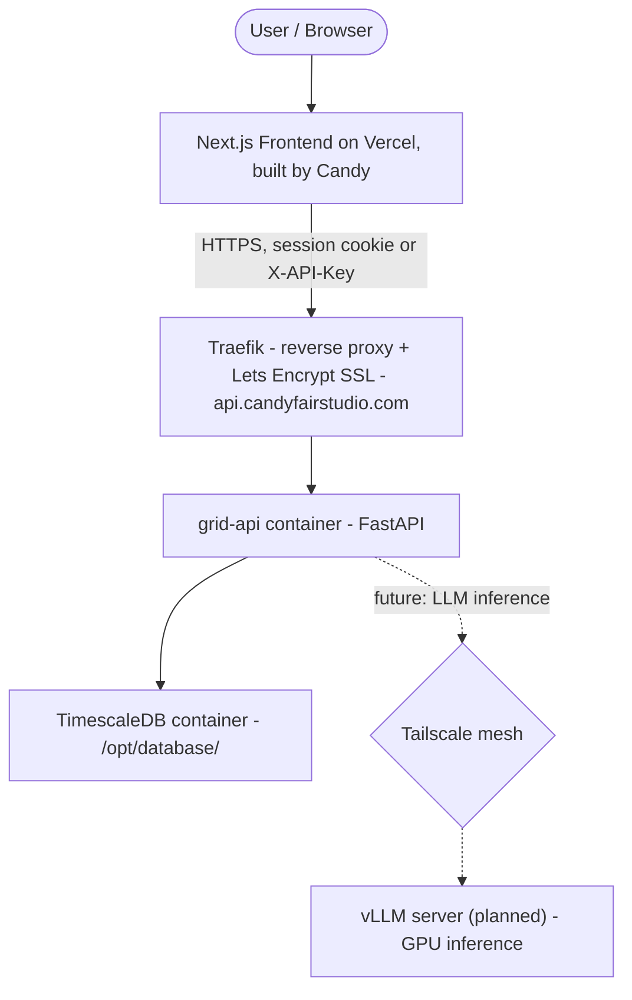
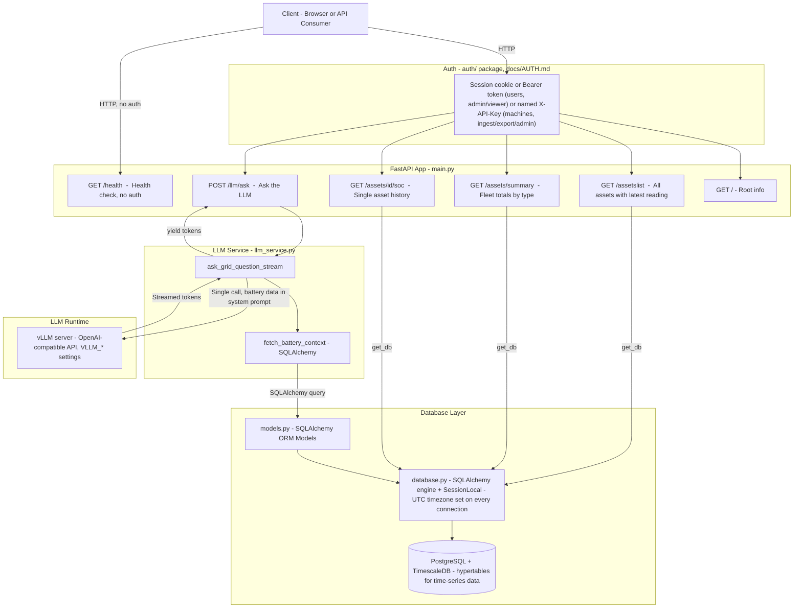
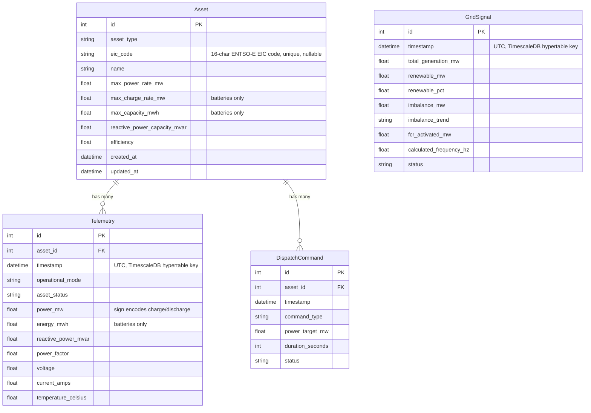

# RADA — Renewable Assets Data Analytics

*Grid-scale renewable energy asset monitoring and AI analytics platform*
*(previously developed under the working name "BESS Grid Manager")*

[](https://github.com/OpenFoundationRenewableOperationGrids/rada-backend/actions/workflows/ci.yml)
[](LICENSE)

RADA is a grid-scale monitoring and analytics platform for renewable energy fleets — batteries (BESS), solar farms, and wind farms. It maintains a registry of assets identified by ENTSO-E EIC codes, ingests 10-minute telemetry into a PostgreSQL/TimescaleDB database, exposes a FastAPI REST API with adaptive time-series downsampling, and answers natural-language questions about the fleet via a locally-running LLM with live database access. 

This is built as the backend counterpart to the **[RADA frontend](https://github.com/OpenFoundationRenewableOperationGrids/rada-frontend)** developed by [Candice Fairand](https://github.com/Candyfair), and is part of the [Open Foundation for Renewable Operation Grids](https://github.com/OpenFoundationRenewableOperationGrids).

Units throughout are **MW** (power), **MWh** (energy), and **MVAr** (reactive power), consistent with grid-scale industry standards.

---

## Table of Contents

1. [Project Overview](#1-project-overview)
2. [Architecture](#2-architecture)
3. [File Structure](#3-file-structure)
4. [Data Models](#4-data-models)
5. [API Endpoints](#5-api-endpoints)
6. [Authentication, Security & CORS](#6-authentication-security--cors)
7. [Environment Configuration](#7-environment-configuration)
8. [Local Development Setup](#8-local-development-setup)
9. [Production Deployment](#9-production-deployment)
10. [Seeding & the Telemetry Simulator](#10-seeding--the-telemetry-simulator)
11. [LLM Integration — Current State & Roadmap](#11-llm-integration--current-state--roadmap)
12. [Frontend](#12-frontend)
13. [Key Architectural Decisions & Learnings](#13-key-architectural-decisions--learnings)
14. [Roadmap — On the Horizon](#14-roadmap--on-the-horizon)
15. [Contributing](#15-contributing)
16. [License](#16-license)

---

## 1. Project Overview

RADA provides:

- A **PostgreSQL database with the TimescaleDB extension**, holding grid-scale asset data — batteries, solar farms, and wind farms — with telemetry stored as time-series hypertables
- **30 days of seeded historical telemetry** at 10-minute resolution, plus a **live telemetry simulator** that continues posting realistic readings every 10 minutes through the same API real assets would use
- A **FastAPI REST backend** for querying asset reference data, current status, and historical telemetry, with **adaptive downsampling** for charting (raw 10-minute data for short ranges, `time_bucket()` aggregation for longer ones, capped at 250 points per response)
- **API key authentication** (toggleable per environment) and CORS configured for the Next.js frontend
- An **LLM integration** (vLLM via its OpenAI-compatible API) that answers natural-language questions about the fleet, with live battery data from the database injected into the prompt — narrating live data rather than guessing from training
- A **production deployment** on a Hetzner VPS behind Traefik with automatic Let's Encrypt SSL, with a Next.js frontend on Vercel

> **Note on naming:** the product is now branded **RADA**. The underlying repos, containers, and directories (`grid-deploy`, `grid-api`, `grid_assets.db` references, etc.) retain their original working names — this is normal and doesn't need to change for the rename to apply at the product level.

---

## 2. Architecture

### Production deployment topology



The VPS runs Docker Compose (project name `www`, network `www_cb_network`) at `/var/www/docker-compose.yml`. TimescaleDB runs as a **separate container** at `/opt/database/`, decoupled from the API container's lifecycle.

### Application-level architecture



### LLM request flow

The `/llm/ask` endpoint uses a **single-pass pattern** in `llm_service.py`:

1. `fetch_battery_context()` queries all battery assets via SQLAlchemy and formats them as text.
2. That data is injected into the system prompt, and one streaming chat-completion request is sent to vLLM through the `openai` SDK (no tool-calling round trip, so inference runs once).
3. The answer is streamed token-by-token back to the client via `StreamingResponse`.

The vLLM request is opened **before** the response starts, so if vLLM is unreachable the endpoint returns **503** rather than an empty 200. The client uses a 60s timeout. If the stream breaks midway, an `[Error: the LLM stream was interrupted]` marker is appended to the text.

This means the LLM **narrates results from live data rather than guessing from training** — see [§13](#13-key-architectural-decisions--learnings) for why this matters.

---

## 3. File Structure

```
rada-backend/
│
├── main.py                 # FastAPI app — routes, CORS, API key auth (verify_api_key), lifespan
├── routers/                # V1.0 routes, one module per part of the API: catalogue.py
│                           #   (/languages, /metrics), measurements.py (ingestion), errors.py
├── database.py             # PostgreSQL/TimescaleDB engine, SessionLocal, Base, get_db()
│                           #   — sets UTC timezone on every connection
├── models.py               # All SQLAlchemy ORM models
├── llm_service.py          # vLLM (OpenAI-compatible) prompt building and streaming
├── telemetry_simulator.py  # Telemetry simulator, started from main.py (TELEMETRY_SIMULATOR)
├── seed_batteries.py       # Seeds 30 days of history for batteries, solar and wind farms
│                           #   (run after `alembic upgrade head`; --reset empties the demo data)
├── mvp_sites.py            # Transitional: gives each new MVP asset a site (DATA_MODEL.md §6.1)
├── seed_metrics.py         # Loads the metric catalogue (seeds/metrics.toml); run on every container start
├── grid_signal_fetcher.py  # RTE grid signals — not wired into main.py yet
├── alembic/, alembic.ini   # Database migrations (see docs/MIGRATIONS.md)
├── bridge/                 # OpenEMS bridge: reads OpenEMS Backends over B2B and posts
│                           #   to the API; runs as its own service (see bridge/README.md)
├── docs/                   # DATA_MODEL.md (V1.0 target schema and metric catalogue),
│                           #   MIGRATIONS.md and findings notes (b2b-findings.md)
├── seeds/                  # Seed data: metric catalogue (metrics.toml) and the
│                           #   default OpenEMS mapping template (openems_mapping.toml)
├── tests/                  # pytest suite (see TESTING.md)
├── .github/workflows/      # CI (lint, tests, Docker build), PR title check,
│                           #   on-demand Claude review (claude-review.yml)
├── REVIEW.md               # Rules for the automated Claude review
├── Dockerfile
├── requirements.txt        # Runtime dependencies (installed in the Docker image)
├── requirements-dev.txt    # + test and development tools (pytest, Ruff)
├── ruff.toml               # Lint configuration
├── .env.example            # Every environment variable, with placeholders
├── .env                    # Local config (not committed)
├── .env.production         # VPS config (not committed)
└── .venv/                  # Virtual environment (not committed)
```

---

## 4. Data Models

Asset reference data and time-series telemetry are split as before, but time-series tables now live in **TimescaleDB hypertables** for efficient range queries and downsampling.

### Entity Relationship Diagram



### Enums

**AssetType**

| Value | Description |
|---|---|
| `battery` | Battery energy storage system (BESS) |
| `solar` | Solar photovoltaic farm |
| `wind` | Wind farm |

**GridConnectionStatus** (`Telemetry.operational_mode`)

| Value | Description |
|---|---|
| `active` | Operating normally — charge/discharge direction read from sign of `power_mw` |
| `curtailed` | Output restricted by grid operator instruction |
| `holding` | Standing by, reserved for frequency response |
| `fault` | Asset is in a fault state |

**AssetStatus** (`Telemetry.asset_status`)

| Value | Description |
|---|---|
| `communicating` | Asset is reachable and reporting data |
| `unreachable` | Asset is not responding |

### Key design decisions

- **Asset = metering point = dispatch unit.** A solar or wind farm is modelled as a single asset at one grid connection point — aligned with how RTE/ENTSO-E metering works.
- **`eic_code` is the canonical identifier**, supporting both GB (Elexon BMU) and French/European (RTE) market contexts. Exactly 16 characters, unique, nullable for unregistered assets.
- **`power_mw` sign convention.** Positive = exporting to the grid (discharging/generating); negative = importing (charging). Direction is not stored as a separate column.
- **Timestamps are always UTC.** `database.py` sets `SET TIME ZONE 'UTC'` on every connection via a SQLAlchemy connect event. The frontend converts to `Europe/Paris` for display.
- **Schema enrichment deferred.** Additional fields (`ambient_temperature_c`, `panel_temperature_c`, `irradiance_w_m2`, `cell_temperature_c`) are planned but deferred until the frontend has UI to render them.

---

## 5. API Endpoints

| Method | Endpoint | Auth required? | Description |
|---|---|---|---|
| `GET` | `/` | Yes (if `AUTH_ENABLED`) | API name and running status |
| `GET` | `/health` | **No, always open** | Health check, returns `healthy` |
| `GET` | `/assetslist` | Yes | All assets with their latest telemetry row joined |
| `GET` | `/assets/summary` | Yes | Fleet-wide totals, broken down by asset type |
| `GET` | `/assets/{asset_id}/soc` | Yes | Single asset — latest record (`mode=S`) or history (`mode=D`) |
| `POST` | `/llm/ask?question=...` | Yes | Streams an LLM answer using live battery data from the DB (503 if vLLM is unreachable) |
| `GET` | `/languages` | Read | Active languages, default first |
| `GET` | `/metrics` | Read | Metric catalogue with every translation, or one language with `?lang=` |
| `POST` | `/metrics` | Admin | Create a custom metric with its names |
| `POST` | `/sites/{site_id}/measurements` | Ingest | Post a batch of measurements (metric keys, W/Wh/var/%) |

"Read", "Admin" and "Ingest" are the `require_read`, `require_admin` and `require_ingest` dependencies of [docs/AUTH.md](docs/AUTH.md) §1. The V1.0 routes live in [`routers/`](routers); [docs/DATA_MODEL.md](docs/DATA_MODEL.md) §8 describes them.

> **Route ordering matters:** `/assets/summary` must be declared **before** `/assets/{asset_id}` in `main.py`, otherwise FastAPI matches `summary` as a path parameter and the summary endpoint becomes unreachable.

All authenticated requests must include:

```
X-API-Key: <API_KEY>
```

When `AUTH_ENABLED=false` (local development), this header is ignored.

---

### `GET /assetslist`

```bash
curl -H "X-API-Key: $API_KEY" "https://api.candyfairstudio.com/assetslist"
```

Returns all assets (batteries, solar, wind) with their latest telemetry row joined. No asset type filter is applied.

```json
[
  {
    "id": 1,
    "asset_type": "battery",
    "eic_code": "17W-0000-0000-0-A",
    "name": "Fluence Gridstack Alpha",
    "max_capacity_mwh": 120.0,
    "max_charge_rate_mw": 60.0,
    "max_power_rate_mw": 60.0,
    "reactive_power_capacity_mvar": 12.0,
    "efficiency": 0.92,
    "timestamp": "2026-04-30T14:30:00Z",
    "operational_mode": "active",
    "asset_status": "communicating",
    "energy_mwh": 87.4,
    "power_mw": -45.2,
    "reactive_power_mvar": 3.1,
    "power_factor": 0.998
  }
]
```

---

### `GET /assets/summary`

```bash
curl -H "X-API-Key: $API_KEY" "https://api.candyfairstudio.com/assets/summary"
```

Returns fleet-wide aggregated totals from the latest telemetry row for each asset, broken down by asset type.

```json
{
  "total_power_mw": -312.5,
  "total_energy_mwh": 2840.1,
  "total_reactive_mvar": 28.4,
  "by_asset_type": {
    "all":     { "power_mw": -312.5, "energy_mwh": 2840.1, "asset_count": 48 },
    "battery": { "power_mw": -210.0, "energy_mwh": 1950.0, "asset_count": 30 },
    "solar":   { "power_mw":  -68.5, "energy_mwh":   540.6, "asset_count": 9 },
    "wind":    { "power_mw":  -34.0, "energy_mwh":   349.5, "asset_count": 9 }
  }
}
```

---

### `GET /assets/{asset_id}/soc`

| Parameter | Required | Description |
|---|---|---|
| `mode` | Yes | `S` — latest record only; `D` — historical records |
| `from_ts` | No | ISO datetime lower bound (D mode only) |
| `to_ts` | No | ISO datetime upper bound (D mode only) |
| `limit` | No | Max points returned in D mode — default `288` (24 hrs at 10-min intervals), **capped at 250 for chart ranges** |

**`mode=S` — latest record:**

```bash
curl -H "X-API-Key: $API_KEY" "https://api.candyfairstudio.com/assets/1/soc?mode=S"
```

**`mode=D` — history with adaptive downsampling:**

```bash
curl -H "X-API-Key: $API_KEY" \
  "https://api.candyfairstudio.com/assets/1/soc?mode=D&from_ts=2026-04-29T00:00:00&to_ts=2026-05-29T23:59:59"
```

Downsampling rule:

- Ranges **≤ 2 days** return raw 10-minute records.
- Longer ranges use TimescaleDB's `time_bucket()`, with bucket size calculated as:

```python
bucket_minutes = ceil((delta_days * 24 * 60) / limit)
```

This keeps chart responses fast and bounded (max 250 points) while allowing drill-down to raw readings for short windows.

Returns `404` if the asset does not exist or has no records. Returns `400` if `mode` is not `S` or `D`, or if a timestamp parameter is not valid ISO format.

---

### Metric catalogue: `GET /languages`, `GET /metrics`, `POST /metrics`

```bash
curl -H "X-API-Key: $API_KEY" "http://127.0.0.1:8000/metrics?lang=fr"
```

```json
[{"id": 4, "key": "battery_power", "unit": "W", "kind": "instantaneous", "level": "both",
  "category": "core", "is_active": true, "language": "fr",
  "name": "Puissance batterie", "sign_note": "Positif = décharge, négatif = charge"}]
```

- Without `lang`, each metric has `translations` (`{"en": {"name", "sign_note"}, "fr": …}`) instead of `language`, `name` and `sign_note`.
- With `lang`, a metric with no name in that language falls back to the default language, and `language` says which was used.
- An unknown or inactive `lang` is a `422`.

`POST /metrics` (administrator) creates a **custom** metric:

```json
{"key": "inverter_temperature", "unit": "°C", "kind": "instantaneous", "level": "asset",
 "translations": {"en": {"name": "Inverter temperature"}, "fr": {"name": "Température onduleur"}}}
```

- A name in the default language is required.
- It returns `201` with the metric in the `GET /metrics` shape.
- `409` if the key exists, whatever its category.
- `422` for an invalid field or an unknown language. A `category` in the body is refused: core and optional metrics come only from `seeds/metrics.toml`.

---

### `POST /sites/{site_id}/measurements`

```bash
curl -X POST -H "X-API-Key: $INGEST_KEY" -H "Content-Type: application/json" \
  "http://127.0.0.1:8000/sites/1/measurements" -d '{
    "source": "bridge-openems",
    "items": [
      {"time": "2026-11-25T10:00:00Z", "metric": "grid_power",    "asset_id": null, "value": 1520.0},
      {"time": "2026-11-25T10:00:00Z", "metric": "battery_power", "asset_id": 49,   "value": -800.0}
    ]}'
```

```json
{"inserted": 2, "ignored": 0}
```

- `source` is required, and is one of `bridge-openems`, `simulator`, `seed`, `csv`.
- A batch holds 1 to `MAX_BATCH_SIZE` (5000) items, and is stored **all or nothing**.
- `time` needs a time zone and is stored in UTC. It may be at most `MAX_FUTURE_SKEW` (5 minutes) in the future.
- `value` is in the metric's unit, and must be finite.
- `asset_id` is `null` for a site-wide value.
- A value already stored (same time, site, asset and metric) is ignored and counted in `ignored`.
- The site's `last_seen_at` moves forward to the latest time stored.
- Rows older than `AGGREGATE_POLICY_START_OFFSET` (3 days, the refresh policy of `measurement_hourly`) are added to the hourly aggregate before the answer.
- `404` for an unknown site.
- `422` lists every invalid item, with its index in `loc`, for example `["body", "items", 3, "metric"]`. The reasons are:
  - unknown or inactive metric;
  - asset not on this site;
  - the metric's level (a `site` metric with an asset, an `asset` metric without one);
  - a time in the future.

Both limits are constants in `routers/measurements.py`, not environment variables.

---

### `POST /llm/ask?question=...`

```bash
curl -X POST -H "X-API-Key: $API_KEY" \
  "https://api.candyfairstudio.com/llm/ask?question=Which+assets+are+currently+curtailed"
```

Streams a plain-text response token by token via `StreamingResponse`. Returns `503` if vLLM is unreachable.

---

## 6. Authentication, Security & CORS

Full details, including the sign-in API contract (C1), are in [docs/AUTH.md](docs/AUTH.md).

- **People** sign in with an email and a password (`POST /auth/login` sets an httpOnly, Secure session cookie; native apps use `POST /auth/token` and send `Authorization: Bearer`). Each account is **admin** (reads and changes configuration, manages users and keys) or **viewer** (reads only). Passwords are hashed with Argon2 (pwdlib) and must be at least 15 characters, with no composition rules. Repeated failed sign-ins are slowed down (429).
- **Machines** use named API keys in the `X-API-Key` header, created by an administrator (`POST /api-keys`), stored hashed, shown once and revocable one by one. Scopes: `ingest` (posts telemetry/measurements; the bridge), `export` (reads data), `admin`.
- **First run:** `GET /auth/setup-status` says whether the installation has no user yet; `POST /auth/setup` creates the first administrator, once. No default password or key is shipped.
- **Legacy key:** the MVP's single `API_KEY` is still accepted, with full access, until the front end and the bridge have switched. It is removed before the release (BE-09).
- `AUTH_ENABLED=false` makes every request an administrator and is refused unless `ENVIRONMENT=development`.
- **`/`, `/health` and the sign-in routes are open** — `/health` is used for container health checks and uptime monitoring.
- **Swagger docs (`/docs`)** are disabled in production via the `ENVIRONMENT` variable, to avoid exposing the schema and a live "try it out" console publicly.
- **CORS** is configured via `CORSMiddleware` in `main.py`, from `CORS_ORIGINS` (default `http://localhost:3000`). For production it must include the frontend's domain — keep it in sync whenever the frontend deployment URL changes. The same list decides which browser origins may write with the session cookie.
- All internal calls (e.g. the telemetry simulator posting to the API) authenticate the same way as external clients, with an `X-API-Key` header (`SIMULATOR_API_KEY`, an `admin`-scope key, falling back to the legacy `API_KEY`).

---

## 7. Environment Configuration

Two environment files, loaded via `python-dotenv`. Start from [`.env.example`](.env.example), which lists every variable:

| File | Used by | Purpose |
|---|---|---|
| `.env` | Local development | `AUTH_ENABLED=false`, local DB connection string, `ENVIRONMENT=development` |
| `.env.production` | VPS (`/var/www/`) | `AUTH_ENABLED=true`, production DB connection string, `ENVIRONMENT=production`, `SIMULATOR_INTERVAL_SEC`, `API_KEY` |

Key variables:

| Variable | Purpose |
|---|---|
| `DATABASE_URL` | PostgreSQL/TimescaleDB connection string |
| `AUTH_ENABLED` | Toggles auth enforcement; `false` is refused outside `ENVIRONMENT=development` |
| `SESSION_SECRET` | **Required when auth is on.** Signs session tokens (32+ characters) |
| `SESSION_TTL_HOURS` | Session lifetime (default 8) |
| `COOKIE_SECURE` | `true` by default; `false` only for local http |
| `CORS_ORIGINS` | Front-end origins, comma-separated (default `http://localhost:3000`) |
| `SETUP_TOKEN` | Optional: `POST /auth/setup` then needs it in `X-Setup-Token` |
| `FORWARDED_ALLOW_IPS` | uvicorn: trust Traefik's `X-Forwarded-For`, so failed sign-ins are counted per client |
| `API_KEY` | **Deprecated.** The MVP's single shared key; removed in BE-09 |
| `ENVIRONMENT` | `development` / `production` — controls Swagger docs visibility |
| `SIMULATOR_INTERVAL_SEC` | Interval (seconds) between simulated telemetry posts |
| `VLLM_BASE_URL` | **Required.** vLLM's OpenAI-compatible endpoint, e.g. `http://<host>:8000/v1`. The app refuses to start without it, so prompts (which include DB data) can never fall back to `api.openai.com` |
| `VLLM_API_KEY` | API key for vLLM, if it was started with `--api-key` (defaults to `not-needed`) |
| `VLLM_MODEL` | Model name served by vLLM (defaults to `Qwen/Qwen2.5-7B-Instruct`) |
| RTE OAuth2 credentials | Stored server-side for Actual Generation / Balancing Energy API calls |
| `BRIDGE_CONFIG`, `RADA_API_URL`, `RADA_API_KEY`, `OPENEMS_*` | OpenEMS bridge only (`python -m bridge`) — see [bridge/README.md](bridge/README.md) |

`.gitignore` excludes both `.env` files and any credentials.

---

## 8. Local Development Setup

### Create and activate the virtual environment

The project uses a virtual environment in `.venv/` (git-ignored). Create it once, then activate it in every new terminal.

**Linux:**
```bash
python3 -m venv .venv
source .venv/bin/activate
```

**macOS:**
```bash
python3 -m venv .venv
source .venv/bin/activate
```

**Windows (PowerShell):**
```powershell
py -m venv .venv
.venv\Scripts\Activate.ps1
```

> If PowerShell blocks the script, run `Set-ExecutionPolicy -Scope CurrentUser RemoteSigned` once. From **Command Prompt** use `.venv\Scripts\activate.bat`; from **Git Bash** use `source .venv/Scripts/activate`.

Once activated, `python`, `pip`, `uvicorn` and `python -m pytest` all use the project's environment on every OS. Run `deactivate` to leave it.

### Install or update dependencies

```bash
pip install -r requirements.txt       # the app only (what the Docker image installs)
pip install -r requirements-dev.txt   # the same, plus pytest and Ruff — needed to run the tests
```

| Package | Purpose |
|---|---|
| `fastapi` | Web framework and REST API |
| `uvicorn` | ASGI server |
| `sqlalchemy` | ORM — models and DB sessions |
| `psycopg2` / `asyncpg` | PostgreSQL driver |
| `openai` | OpenAI-compatible client, pointed at vLLM via `VLLM_BASE_URL` |
| `python-dotenv` | Load environment variables from `.env` |

### Configure the environment

```bash
cp .env.example .env
```

Then set at least `DATABASE_URL` and `VLLM_BASE_URL` (see [Environment Configuration](#7-environment-configuration)).

### Create the schema

```bash
alembic upgrade head
```

Migrations are the only thing that creates or changes tables. See [docs/MIGRATIONS.md](docs/MIGRATIONS.md), including the pinned TimescaleDB container for local development.

### Run the API locally

```bash
uvicorn main:app --reload
```

With `AUTH_ENABLED=false`, all endpoints can be called without a key. Swagger docs are available at:

```
http://127.0.0.1:8000/docs
```

---

## 9. Production Deployment

The VPS (Hetzner CAX11, **ARM64**, Ubuntu) runs Docker Compose at `/var/www/docker-compose.yml` (project name `www`, network `www_cb_network`). TimescaleDB runs in its **own container** at `/opt/database/`, separate from the API container.

### Upgrading an existing database

The API container runs `alembic upgrade head` and then `python seed_metrics.py` before it starts, so pending migrations and the metric catalogue are applied on every deploy. If either fails, the API does not start: see [docs/MIGRATIONS.md](docs/MIGRATIONS.md#api-container-wont-start-after-a-deploy). A database created before Alembic must be stamped once first: follow the one-off upgrade in [docs/MIGRATIONS.md](docs/MIGRATIONS.md).

> **Stamp before the new image starts.** On a database that is not stamped, the migrations fail and the API container does not start.

### Standard deploy sequence

```bash
cd ~/grid-deploy && git pull && \
  docker build --no-cache -t grid-api:latest . && \
  sudo docker compose -f /var/www/docker-compose.yml up -d grid-api
```

To stop the API container:

```bash
sudo docker compose -f /var/www/docker-compose.yml stop grid-api
```

> **ARM64 vs amd64:** the VPS is ARM64. Docker images must be **built natively on the VPS** — images built on an amd64 development machine cannot be transferred. `docker build --no-cache` is the established pattern to avoid stale layer caching on rebuild.

### Seeding in production

Seed scripts run **inside** the running container:

```bash
docker exec grid_api python seed_batteries.py
```

The script refuses to run when assets already exist. It loads the metric catalogue first. `--reset` first empties `dispatch_commands`, `state_of_charge`, `grid_signals`, `measurement`, `metric_mapping`, `tariff`, `fixed_asset_link`, `fixed_asset`, `discovered_component`, `assets`, `site` and `portfolio`, which deletes **all** their data, including the assets fed by the OpenEMS bridge and their sites. The catalogue (`language`, `metric`, `metric_translation`) and `source_connection` are kept.

### Traefik & SSL

Traefik handles all HTTPS termination and Let's Encrypt certificates for `api.candyfairstudio.com` automatically — certificates are never managed manually.

### Tailscale / DNS note

Tailscale can take over `/etc/resolv.conf` on the VPS, breaking Docker's DNS resolution for public domains (e.g. pulling base images, reaching `pypi.org`). Fix: set Docker's `daemon.json` to use `8.8.8.8` as a DNS server.

---

## 10. Seeding & the Telemetry Simulator

### Seeding

The seed scripts populate **30 days of realistic historical data at 10-minute resolution** across the fleet:

| Profile | Behaviour |
|---|---|
| **Battery** | State of charge starts at 60–85% of capacity and respects a 15% discharge floor — realistic for protecting battery chemistry |
| **Solar** | Generation follows a daylight bell curve; storage fields are `None` (not applicable) |
| **Wind** | Sinusoidal pattern with random variation |
| **Grid signals** | Frequency, voltage, demand, and renewable percentage, recorded every 5 minutes |

### Telemetry simulator

After seeding, the simulator keeps the dataset "live":

- Runs on a configurable interval (`SIMULATOR_INTERVAL_SEC`)
- **Skips every asset with an `edge_id`**: those are fed by the OpenEMS bridge (`bridge/`), so real and invented readings never mix
- Posts new readings for every asset via **authenticated internal HTTP calls** to the same API real assets would use:

```python
HEADERS = {"X-API-Key": API_KEY}
```

This means the frontend and LLM always see data arriving through the real ingestion path — there is no separate "simulation" code path in the API itself.

---

## 11. LLM Integration — Current State & Roadmap

### Current: vLLM via its OpenAI-compatible API

`llm_service.py` uses the `openai` SDK pointed at vLLM (`VLLM_BASE_URL`, `VLLM_API_KEY`, `VLLM_MODEL` — see [§7](#7-environment-configuration)). Any OpenAI-compatible server works for local development, as long as `VLLM_BASE_URL` points at it.

Tests never contact vLLM: `tests/test_llm_ask.py` mocks the client, and CI sets a dummy `VLLM_BASE_URL`.

### Previously: Ollama + Mistral

Earlier versions called Ollama's `mistral:7b-instruct` directly (~60–75s time-to-first-token cold on a CPU-only laptop). This was replaced by vLLM for its OpenAI-compatible API and much faster time-to-first-token on a GPU.

### Planned: production routing

- **Network routing:** the vLLM server joins the existing Tailscale mesh; Traefik on the VPS proxies inference requests through the tunnel to vLLM. This keeps GPU workloads entirely off the VPS's 4GB RAM.
- This component is **not yet active in production**.

---

## 12. Frontend

The frontend is developed by [@Candyfair](https://github.com/Candyfair) (Candy) as a separate Next.js application, hosted on Vercel:

**[OpenFoundationRenewableOperationGrids/rada-frontend](https://github.com/OpenFoundationRenewableOperationGrids/rada-frontend)**

Frontend responsibilities include:

- Fleet-wide **bubble chart** on login — bubble size reflects current charge/discharge relative to the fleet, bubble colour indicates telemetry health, with a fleet total for the selected asset type
- Filtering by asset type
- Asset detail view — current metrics, plus charting any metric over a user-defined time window, with multi-asset comparison
- Light and dark mode
- Converting UTC timestamps from the API to `Europe/Paris` for display

Frontend documentation is maintained in the [rada-frontend README](https://github.com/OpenFoundationRenewableOperationGrids/rada-frontend#readme), with cross-references back to this backend README where relevant.

---

## 13. Key Architectural Decisions & Learnings

- **LLMs narrate, Python computes.** A 3,836 kWh discrepancy was observed when Mistral performed arithmetic directly on production data. All numerical computation happens in dedicated SQLAlchemy/Python functions; the LLM selects and narrates results only.
- **Asset = metering point = dispatch unit.** A solar or wind farm is one asset at one grid connection point — standard practice aligned with RTE/ENTSO-E metering.
- **EIC codes as canonical identifiers**, supporting both GB (Elexon BMU) and French/European (RTE) contexts.
- **Adaptive downsampling.** Ranges ≤ 2 days return raw 10-minute records; longer ranges use `time_bucket()` with `bucket_minutes = ceil((delta_days * 24 * 60) / limit)`.
- **Charge/discharge direction is encoded in the sign of `power_mw`**, not a separate enum.
- **ARM64 vs amd64.** The VPS is ARM64 — Docker images must be built natively on it.
- **Tailscale/DNS conflict.** Tailscale can hijack `/etc/resolv.conf`; fix via `daemon.json` with `8.8.8.8`.
- **FastAPI route ordering.** More specific routes (`/assets/summary`) must be declared before parameterised routes (`/assets/{asset_id}`).
- **vLLM over Ollama** for production inference, once GPU hardware is available — OpenAI-compatible API and much lower time-to-first-token on a GPU.

---

## 14. Roadmap — On the Horizon

- [ ] **vLLM server in production** — integrated via the `openai` SDK pointed at vLLM's `base_url`
- [ ] **Tailscale routing for LLM traffic** — Traefik on the VPS proxying through the tailnet to the vLLM server
- [ ] **Continuous deployment** — automatic deploy on push (CI already runs the tests and the Docker build on every pull request)
- [ ] **Architecture & installation documentation** — DB and backend as separate containers; frontend docs handled separately by Candy
- [ ] **Schema enrichment** — `ambient_temperature_c`, `panel_temperature_c`, `irradiance_w_m2`, `cell_temperature_c`, deferred until the frontend can render them
- [ ] **Headscale** — self-hosted Tailscale coordination server, deployable on the existing VPS once the stack is stable

---

## 15. Contributing

Contributions are welcome! Read [CONTRIBUTING.md](CONTRIBUTING.md) to get started, and [TESTING.md](TESTING.md) to write tests. Pull requests target `develop`.

To report a security issue, follow [SECURITY.md](SECURITY.md) — please don't open a public issue.

### Automated code review

Once a pull request is ready, an admin can comment `@claude review` (as a top-level comment) to get a review from Claude, posted as inline comments with a summary. It complements the maintainer's review and doesn't replace it.

- **Workflow:** [`.github/workflows/claude-review.yml`](.github/workflows/claude-review.yml), running [`anthropics/claude-code-action`](https://github.com/anthropics/claude-code-action) with the official `code-review` plugin and the `claude-opus-5-5` model.
- **Rules:** [REVIEW.md](REVIEW.md) sets what counts as blocking, what to skip and what to always check.
- **Who can trigger it:** only [@Candyfair](https://github.com/Candyfair) and [@roadtowiganpier](https://github.com/roadtowiganpier), whose Claude accounts and tokens are used across both RADA repositories. The list is in the workflow's `if` condition; a comment from anyone else is ignored. Nothing runs automatically on open or push.
- **Skipped:** draft pull requests, and pull requests that already have a comment from Claude.
- **Credentials:** the `CLAUDE_CODE_OAUTH_TOKEN` repository secret, a Claude Pro subscription token generated with `claude setup-token`. Reviews count against that subscription's usage limits. The token is currently provided by [@Candyfair](https://github.com/Candyfair): if reviews stop working, or if the token needs to be replaced, contact her.

---

## 16. License

Copyright 2026 openfrog.org

Licensed under the [Apache License, Version 2.0](LICENSE).

---

*RADA · FastAPI · SQLAlchemy · PostgreSQL + TimescaleDB · vLLM · Docker · Traefik · Next.js · Python*
