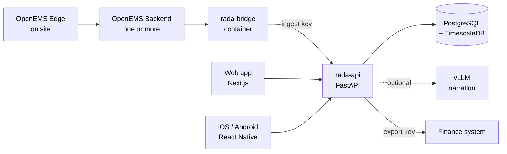

# RADA backend — V1.0 specification

*[Français ci-dessous](#spécification-du-backend-rada-v10)* <!-- French section to be added before merge, per the definition of done -->

This file is the stable "what and why" of the backend. It changes when a decision changes, not every
sprint. The detailed "how" lives elsewhere:

- **Stories and acceptance criteria:** GitHub issues `BE-xx`, grouped by epics `E1`–`E9`, tracked on
  [org Project 1](https://github.com/orgs/OpenFoundationRenewableOperationGrids/projects/1).
- **Schema:** `docs/DATA_MODEL.md` and the Alembic revisions (the revisions win).
- **API contract with the front ends:** BE-15 (#55).

If a story contradicts this file, raise it in the issue before building; then update this file in
the same PR as the decision.

## 1. Purpose

RADA consolidates real-time telemetry from behind-the-meter renewable assets — batteries, PV and wind
— across one or more OpenEMS installations, computes standard KPIs, explains them in plain language,
and exports period data to finance systems.

It must be good in its own right: not a budget or home product.

## 2. Users

| User | Needs |
|---|---|
| Community (small O&M providers, community energy, social housing, local councils) | One view across sites, simple install, plain-language summaries |
| Commercial (companies with behind-the-meter assets on several sites) | Multi-site consolidation, exports to their ERP, controlled access |
| Administrator | Install, connect OpenEMS Backends, confirm discovered assets, manage users and keys |
| Viewer | Read portfolio, site and asset data; cannot change configuration |
| Machine client | Bridge (ingest), finance system (export), via scoped API keys |

## 3. Scope of V1.0

In scope:

1. **OpenEMS ingestion** (E1): a separate `rada-bridge` container reads from one or more OpenEMS
   Backends (B2B websocket, polling as fallback) and posts to the RADA API. RADA discovers an edge's
   components and proposes them; an administrator confirms them.
2. **Data warehouse** (E2): portfolio → site → asset hierarchy; a site can hold several assets and
   asset-level detail always stays visible. Measurements in a TimescaleDB hypertable with hourly
   continuous aggregates.
3. **Metrics** (E1/E3): a catalogue of core metrics plus user-mapped custom metrics; OpenEMS channels
   mapped to metrics per site. Metric names translated in English, French and German.
4. **KPIs and analytics** (E3): computed in Python/SQL by a KPI engine, daily per site and per asset,
   verified against a reference dataset.
5. **Read API** (E4) for the web app and the iOS/Android apps, contract-first.
6. **Finance export** (E5): outbound only, by day and by calendar month. ERP fixed-asset data sits in
   separate link tables.
7. **Narration** (E6): optional vLLM component; the model chooses which Python functions to call and
   narrates their results. Evaluated against a fixed question set.
8. **Access** (E7): email and password, administrator and viewer roles, named and scoped API keys.
   SSO fields exist on the user table but are not used in V1.0.
9. **Packaging** (E8): multi-arch (ARM64/amd64) images on `ghcr.io`, an install bundle, an install
   guide, release checks and a `v1.0` tag.

Out of scope for V1.0: front-of-the-meter assets, heat pumps, SSO/SAML login, RBAC beyond two roles,
alerting and anomaly detection (one time-boxed exploration only, BE-14), forecasting, inbound ERP
integration, collective self-consumption, customer isolation (multi-tenant).

## 4. Architecture

Deployed as separate containers (front end, API, database, bridge, optional vLLM) started with simple
terminal commands. Each environment has its own database.

## 5. Invariants

These hold for every change. They are also listed for Claude in `CLAUDE.md`.

- **LLMs narrate, Python computes.** No number in an answer is produced by the model.
- **UTC** for storage and the API.
- **Units:** W, Wh, var, % with OpenEMS sign conventions in V1.0 tables.
- **Stable keys:** integer ids are the keys; OpenEMS names (`edge0`, `ess0`) are attributes used for
  matching, so history survives renames.
- **Deactivate, don't delete** reference rows.
- **Languages are data:** translations in `…_translation` tables; adding a language needs no schema
  change. The interface is EN/FR; German is catalogue-only in V1.0.
- **The schema is defined by Alembic.** Models and revisions agree (CI checks).
- **No default key or password ships** in a release.

## 6. Quality bar (definition of done)

- CI green (lint, `pip check`, tests, migrations on an empty and an MVP database, Docker build).
- One other team member approved the PR.
- Deployed to preprod and the story's verification step carried out.
- Documentation updated in English and French.

## 7. Open questions

- Sign-in design (BE-04): owned by Laurentiu; the two-tier idea (built-in accounts by default, an
  optional external identity server for organisations wanting MFA/SAML) is a proposal, not a decision.
- Whether `main.py` is split into routers as BE-04/05/06 add endpoints.

---

# Spécification du backend RADA V1.0

*À traduire avant la fusion.*
