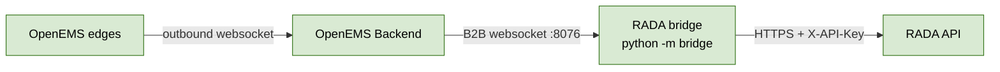

# RADA OpenEMS bridge

*[Français ci-dessous](#bridge-openems-de-rada)*

The bridge reads live values from one or more **OpenEMS Backends** through their Backend-to-Backend (B2B) websocket and posts them to the RADA API. It never connects to an edge directly: each Backend relays the values of every edge registered with it.



It runs as **its own process**, separate from the API, from the **same Docker image**.

## What it does

For each Backend in the config:

1. Connects with HTTP Basic Auth, calls `getEdgesStatus`, then `subscribeEdgesChannels` for the channels its assets need.
2. Receives `edgesCurrentData` every 2 seconds and keeps the latest value of each channel, stamped in UTC on arrival (OpenEMS sends no timestamp).
3. Every `post_interval_sec` (60 s by default), posts one record per asset to `POST /assets/{asset_id}/telemetry`.
4. Reconnects by itself when the connection drops: after 1 s, then 2, 4 … up to 60 s, back to 1 s once data flows.

| Asset kind | Channels read | Posted |
|---|---|---|
| `battery` | `<component>/ActivePower` (W), `/Soc` (%), `/Capacity` (Wh) | `power_mw` = W ÷ 10⁶ (negative = charging), `energy_mwh` = SoC/100 × capacity ÷ 10⁶ |
| `solar` | `<component>/ActivePower` (W) | `power_mw` = W ÷ 10⁶ (positive = producing), `energy_mwh` = 0 |

An asset is skipped (with a warning in the log) when one of its values hasn't arrived, is empty on the edge, or is more than 30 s old.

> This posting to the existing telemetry endpoint is temporary. With BE-03 and BE-05, the bridge will post raw channels to a generic measurements endpoint and discover assets itself.

## Configuration

1. Copy the example and set the RADA asset ids:
   ```bash
   cp bridge/connections.example.toml bridge/connections.toml
   ```
   `connections.toml` is ignored by git. It holds no secrets: each connection names the environment variables that hold its credentials.
2. Set the environment variables, in `.env` or the container's environment:

| Variable | Purpose |
|---|---|
| `BRIDGE_CONFIG` | Path to the TOML file (default `bridge/connections.toml`) |
| `RADA_API_URL` | Base URL of the RADA API, e.g. `https://preprod-api.candyfairstudio.com` |
| `RADA_API_KEY` | The API's `X-API-Key` |
| `OPENEMS_VPS_USER`, `OPENEMS_VPS_PASSWORD` | Credentials of the Backend named `vps` in the example (one pair per connection, names of your choice) |
| `LOG_LEVEL` | `INFO` by default; `DEBUG` shows every stored record |

## Running

From the repository root, with the virtual environment active:

```bash
# Read from OpenEMS and log what would be posted, without posting anything
python -m bridge --dry-run

# For real
python -m bridge
```

Stop with Ctrl+C. In Docker, `docker stop` stops it cleanly too.

As a second service of the same image in Docker Compose:

```yaml
rada-bridge-preprod:
  image: rada-app-preprod:latest
  command: python -m bridge
  env_file: .env.bridge.preprod
  volumes:
    - ./bridge.connections.toml:/app/bridge/connections.toml:ro
  restart: unless-stopped
  networks: [cb_network]
```

## Tests

```bash
python -m pytest bridge -v
```

The bridge tests need no database and no network: a fake OpenEMS Backend plays the websocket, and httpx's mock transport plays the RADA API.

## Requirements on the OpenEMS side

- The `Backend2Backend.Websocket` component is enabled on the Backend (Felix, port 8076), and the port is reachable from where the bridge runs (Tailscale only, never public).
- Each edge has a Timedata component (for example `Timedata.Rrd4j`): without one, OpenEMS reports no energy counters.

Findings from proving this path: [docs/b2b-findings.md](../docs/b2b-findings.md).

---

# Bridge OpenEMS de RADA

Le bridge lit les valeurs en direct d'un ou plusieurs **Backends OpenEMS** via leur websocket Backend-to-Backend (B2B) et les envoie à l'API RADA. Il ne se connecte jamais directement à un edge : chaque Backend relaie les valeurs de tous les edges qui y sont enregistrés.

Il tourne comme **un processus à part**, séparé de l'API, à partir de **la même image Docker**.

## Ce qu'il fait

Pour chaque Backend de la configuration :

1. Se connecte en HTTP Basic Auth, appelle `getEdgesStatus`, puis `subscribeEdgesChannels` pour les channels dont ses actifs ont besoin.
2. Reçoit `edgesCurrentData` toutes les 2 secondes et garde la dernière valeur de chaque channel, horodatée en UTC à la réception (OpenEMS n'envoie pas d'horodatage).
3. Toutes les `post_interval_sec` (60 s par défaut), envoie un enregistrement par actif à `POST /assets/{asset_id}/telemetry`.
4. Se reconnecte seul quand la connexion tombe : après 1 s, puis 2, 4 … jusqu'à 60 s, et revient à 1 s dès que les données circulent.

| Type d'actif | Channels lus | Envoyé |
|---|---|---|
| `battery` | `<composant>/ActivePower` (W), `/Soc` (%), `/Capacity` (Wh) | `power_mw` = W ÷ 10⁶ (négatif = charge), `energy_mwh` = SoC/100 × capacité ÷ 10⁶ |
| `solar` | `<composant>/ActivePower` (W) | `power_mw` = W ÷ 10⁶ (positif = production), `energy_mwh` = 0 |

Un actif est ignoré (avec un avertissement dans le journal) quand l'une de ses valeurs n'est pas arrivée, est vide sur l'edge, ou date de plus de 30 s.

> L'envoi vers l'endpoint de télémétrie actuel est provisoire. Avec BE-03 et BE-05, le bridge enverra les channels bruts à un endpoint de mesures générique et découvrira lui-même les actifs.

## Configuration

1. Copier l'exemple et renseigner les identifiants des actifs RADA :
   ```bash
   cp bridge/connections.example.toml bridge/connections.toml
   ```
   `connections.toml` est ignoré par git. Il ne contient aucun secret : chaque connexion nomme les variables d'environnement qui portent ses identifiants.
2. Définir les variables d'environnement, dans `.env` ou dans l'environnement du conteneur :

| Variable | Rôle |
|---|---|
| `BRIDGE_CONFIG` | Chemin du fichier TOML (par défaut `bridge/connections.toml`) |
| `RADA_API_URL` | URL de base de l'API RADA, par exemple `https://preprod-api.candyfairstudio.com` |
| `RADA_API_KEY` | Le `X-API-Key` de l'API |
| `OPENEMS_VPS_USER`, `OPENEMS_VPS_PASSWORD` | Identifiants du Backend nommé `vps` dans l'exemple (une paire par connexion, noms au choix) |
| `LOG_LEVEL` | `INFO` par défaut ; `DEBUG` affiche chaque enregistrement stocké |

## Lancement

Depuis la racine du dépôt, environnement virtuel activé :

```bash
# Lire depuis OpenEMS et journaliser ce qui serait envoyé, sans rien envoyer
python -m bridge --dry-run

# Pour de vrai
python -m bridge
```

Arrêt avec Ctrl+C. Dans Docker, `docker stop` l'arrête aussi proprement. Pour Docker Compose, voir l'exemple de service dans la partie anglaise.

## Tests

```bash
python -m pytest bridge -v
```

Les tests du bridge n'ont besoin ni de base de données ni de réseau : un faux Backend OpenEMS joue le websocket, et le transport simulé de httpx joue l'API RADA.

## Prérequis côté OpenEMS

- Le composant `Backend2Backend.Websocket` est activé sur le Backend (Felix, port 8076), et le port est joignable depuis l'endroit où tourne le bridge (Tailscale uniquement, jamais public).
- Chaque edge a un composant Timedata (par exemple `Timedata.Rrd4j`) : sans lui, OpenEMS ne fournit aucun compteur d'énergie.

Constats issus de la validation de ce chemin : [docs/b2b-findings.md](../docs/b2b-findings.md).
