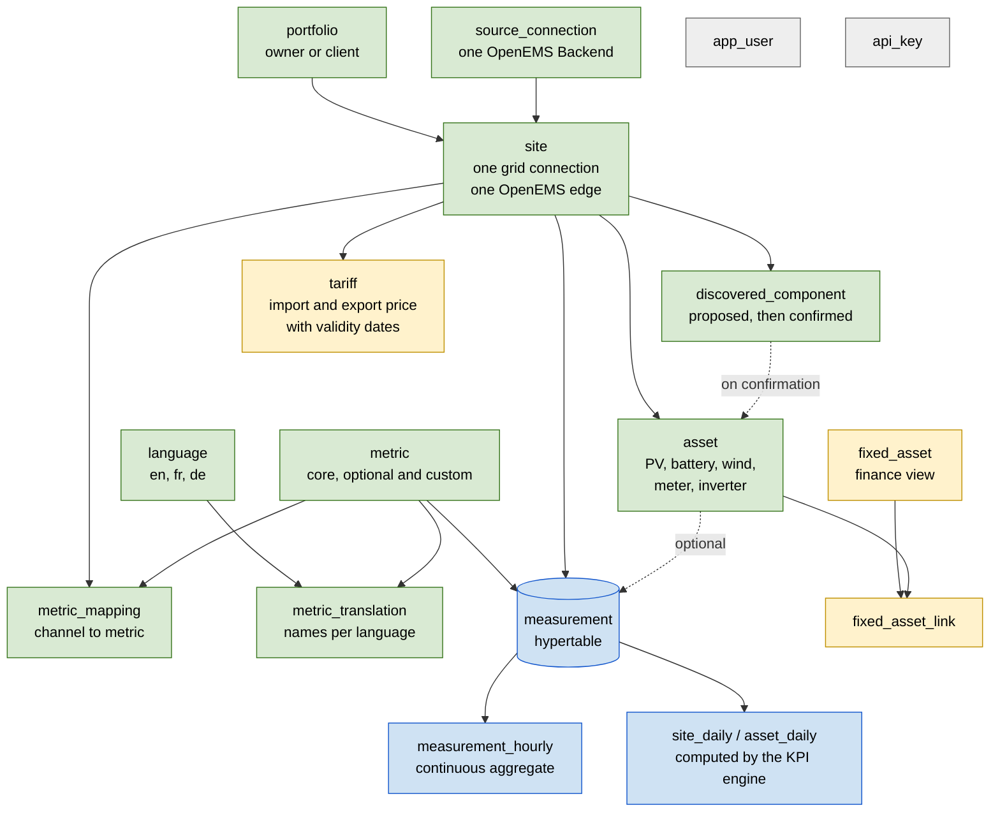

# RADA V1.0 data model

*[Français ci-dessous](#modèle-de-données-rada-v10)*

Target schema for V1.0. Table and column names are proposals until the BE-03 migrations are approved; after that, this file follows the migrations.

Status: kickoff draft of 11 October 2026, updated for BE-02 (#30) on 14 November 2026 with the decisions from the BE-01 findings (`docs/b2b-findings.md`) and the BE-02/BE-03 working session, and for BE-03 (#31) on 17 November 2026. **The schema now follows the Alembic migrations** (`alembic/versions/`, see `docs/MIGRATIONS.md`): where this file and the migrations differ, the migrations are right and this file is to be fixed.

## §1 Overview

Conventions:

- Timestamps are `timestamptz`, stored in UTC.
- Every reference table has `id`, `created_at` and `updated_at`. They are omitted from the tables below. Two tables have a natural key instead of `id`: `language` (its code) and `metric_translation` (metric and language).
- Reference rows are deactivated (`is_active`), not deleted, so history stays consistent.
- **Storage units are W, Wh, var and %**, as OpenEMS reports them (confirmed on the live edge, 7 November 2026). The front end displays kW, kWh and kvar (MW and MWh where values are large).
- **Languages are data.** Translated text lives in `…_translation` tables keyed by language, so a language is added without a schema change. English, French and German ship out of the box (German matches the OpenEMS vocabulary). V1.0 translates the metric catalogue; the interface itself is in English and French.
- The integer `id` is the real key everywhere. OpenEMS names (`edge0`, `ess0`) are attributes used for matching, so history survives a component being renamed or replaced.

## §2 Reference tables

### portfolio

The owner or client that sites are grouped and reported by.

| Column | Type | Notes |
|---|---|---|
| name | text | Unique |
| external_ref | text, nullable | The customer or company code in the finance system |
| currency | char(3) | ISO 4217; default for the portfolio's sites |

### source_connection

One data source, in 1.0 one OpenEMS Backend. Edge IDs are only unique within one Backend (every install starts with `edge0`), so a site is identified by its connection and its edge.

| Column | Type | Notes |
|---|---|---|
| name | text, unique | For example `openems-vps` |
| kind | enum | `openems` in 1.0 |
| url | text | For example the B2B websocket address |

Secrets (user, password) stay in environment variables, never in the database.

### site

A physical location with one grid connection, mapped to at most one OpenEMS edge.

| Column | Type | Notes |
|---|---|---|
| portfolio_id | FK portfolio | Required |
| name | text | |
| source_connection_id | FK source_connection, nullable | Empty for a site with no live source (demo, CSV import) |
| edge_id | text, nullable | The OpenEMS edge identifier, for example `edge0`. Unique on (`source_connection_id`, `edge_id`), and unique on its own among sites with no connection (a partial unique index: two empty connections would not count as equal) |
| timezone | text | IANA name, for example `Europe/Paris`. Required: days and months follow it |
| currency | char(3), nullable | Overrides the portfolio's currency |
| latitude, longitude | numeric, nullable | Moves here from `asset` |
| export_limit_w | integer, nullable | Grid export limit, as data only |
| external_ref | text, nullable | Cost centre or business unit in the finance system |
| last_seen_at | timestamptz, nullable | Time of the last value received; drives the status |

### asset

Existing table, extended. One piece of equipment at a site.

| Column | Type | Notes |
|---|---|---|
| site_id | FK site | Required. Existing MVP assets get a site each in the migration (§6) |
| asset_type | enum | Existing `battery`, `solar`, `wind`; adds `meter` (grid meter) and `inverter` |
| name | text | |
| source_component | text, nullable | The OpenEMS component, for example `ess0`. Partial unique key on (`site_id`, `source_component`) where not null |
| serial_number, manufacturer, model | text, nullable | |
| commissioning_date, warranty_end | date, nullable | |
| rated_power_w | integer, nullable | Installed power; for PV this is the peak power used for specific yield |
| capacity_wh | integer, nullable | Usable battery capacity, used for equivalent full cycles |

- The table keeps its MVP name, `assets` (plural); the tables added in V1.0 are singular.
- `asset_type` is the MVP exception to enum storage: it stores the member names (`'BATTERY'`, `'METER'`). Every V1.0 enum stores its lowercase value (`'pending'`).
- `eic_code` stays a plain attribute, never a lookup key: behind-the-meter assets rarely have one.
- The MVP columns (`max_capacity_mwh`, `max_charge_rate_mw`, `max_discharge_rate_mw`, `reactive_power_capacity_mvar`, `efficiency`, `latitude`, `longitude`, `edge_id`) stay until the front end has switched to the new endpoints, then are migrated or dropped in a later migration.
- **TODO:** `rated_power_w` and `capacity_wh` are empty after revision 0002. The migration that drops the MVP columns copies them first: `max_discharge_rate_mw` ×10⁶ into `rated_power_w` and `max_capacity_mwh` ×10⁶ into `capacity_wh`.

### discovered_component

What the discovery job (BE-05) found on an edge, waiting for an administrator. Kept apart from `asset`, so measurements and KPIs only ever see confirmed assets.

| Column | Type | Notes |
|---|---|---|
| site_id | FK site | |
| source_component | text | For example `ess1`. Unique on (`site_id`, `source_component`) |
| alias, factory_id | text, nullable | As reported by `getEdgeConfig` |
| natures | text[] | OpenEMS natures, for example `SymmetricEss` |
| suggested_asset_type | enum, nullable | Same values as `asset.asset_type` |
| status | enum | `pending`, `confirmed` or `ignored` |
| first_seen_at, last_seen_at | timestamptz | |
| asset_id | FK asset, nullable | Set on confirmation |

Rule for battery clusters: when an `Ess.Cluster` component groups other ESS components, discovery proposes the members as assets and suggests `ignored` for the cluster, because the site totals (`_sum`) already include it. Confirming both would count the same battery twice at asset level.

### metric

The catalogue of what can be measured.

| Column | Type | Notes |
|---|---|---|
| key | text, unique | For example `battery_power`. Language-neutral: used by the API, the bridge, the KPIs and exports |
| unit | text | `W`, `Wh`, `var`, `%`, or any unit for a custom metric |
| kind | enum | `instantaneous`, `cumulative` or `state` |
| level | enum | `site`, `asset` or `both` |
| category | enum | `core`, `optional` or `custom` (see §3) |

Display names and sign notes are in `metric_translation`. Core and optional metrics ship with RADA (seed file `seeds/metrics.toml`) and cannot be deleted. Custom metrics are created by an administrator.

- `key` is lowercase letters, digits and `_`, starting with a letter (`ck_metric_key_format`).
- **Loading the catalogue.** `seed_metrics.py` loads `seeds/metrics.toml` on every API container start and from the demo seed; a run with nothing new writes no row. It adds languages, metrics and translations and updates names, sign notes and a metric's category. It sets the default language only while the install has none, so an administrator's choice survives restarts. It refuses, naming the metric, to change the `unit`, `kind` or `level` of an existing metric (rows were stored under them: that needs a migration), to reuse a custom metric's key, or to create a custom metric. It never deletes.

### language

The languages an install supports.

| Column | Type | Notes |
|---|---|---|
| code | text, primary key | BCP 47 code: `en`, `fr`, `de` |
| name | text | The language's own name: English, Français, Deutsch |
| is_default | boolean | Exactly one row; `en` out of the box. Used when a translation is missing. The database allows at most one (`uq_language_single_default`); the catalogue loader sets one when there is none |
| is_active | boolean | |

### metric_translation

One row per metric and language.

| Column | Type | Notes |
|---|---|---|
| metric_id | FK metric | Primary key with `language_code` |
| language_code | FK language | |
| name | text | For example `Netzleistung` |
| sign_note | text, nullable | For example `positiv = Netzbezug` |

- Every metric has a translation in the default language; other languages fall back to it.
- Other reference data that needs translating later (asset type labels, for example) gets its own `…_translation` table on the same pattern. There is no generic translation table, because it could not use foreign keys.

### metric_mapping

Which source channel feeds which metric. Read and applied by the bridge.

| Column | Type | Notes |
|---|---|---|
| site_id | FK site | |
| asset_id | FK asset, nullable | Empty for a site-wide value. Must belong to the site |
| metric_id | FK metric | Its `level` must allow the asset to be filled in or empty |
| source | text | `openems` in 1.0 |
| source_address | text | The channel address, `component/channel`, for example `ess0/ActivePower` |
| scale | numeric | Multiplier applied to the raw value; default 1 |
| is_enabled | boolean | |

Unique on (`site_id`, `source`, `source_address`). The edge is not repeated: it comes from the site.

- "Must belong to the site" is a composite foreign key on (`asset_id`, `site_id`).
- The level rule (§3.1) is a trigger, `check_metric_level()`, raised as `ck_metric_level`. A second trigger refuses a change of a metric's `level` that existing rows contradict. `measurement` (§4) uses the same rule.

## §3 Metrics

### §3.1 Rules

- **One key per physical quantity.** `battery_power` is both the site's battery total and each battery's own power. Whether `asset_id` is filled in says which.
- **Empty asset means site-wide.** A site-level value is what the source reports for the site (in OpenEMS, the `_sum` component). It is usually a total over assets but RADA does not calculate it, and some site metrics have no asset breakdown at all (`consumption_power` is calculated by OpenEMS from the meters).
- **Granularity.** Each confirmed asset has its own rows. Site KPIs read only site rows; asset KPIs read only asset rows; a query never adds the two together.
- **Level check.** A metric with level `site` cannot be mapped or posted with an asset; level `asset` requires one; `both` accepts either.
- **Signs** follow OpenEMS: grid positive is import, negative is export; battery positive is discharge, negative is charge; production and consumption are always positive. At every instant: `consumption_power = production_power + grid_power + battery_power` (site rows).
- **Production includes every generator.** `_sum/ProductionActivePower` adds PV and wind. Per-asset rows keep them apart through `asset.asset_type`.

### §3.2 Core metrics

Core metrics have a default mapping, and the KPIs (`SPEC.md` §6) are calculated from them. Site channels verified on `edge0` (`2026.1.0`) on 7 November 2026, signs included. Asset channels are verified in the BE-02 verification step.

| Key | Name (EN / FR / DE) | Unit | Kind | Level | Site channel | Asset channel | Sign |
|---|---|---|---|---|---|---|---|
| `production_power` | Production power / Puissance produite / Erzeugungsleistung | W | instantaneous | both | `_sum/ProductionActivePower` | PV or wind meter `ActivePower` | always positive |
| `consumption_power` | Consumption power / Puissance consommée / Verbrauchsleistung | W | instantaneous | site | `_sum/ConsumptionActivePower` | — | always positive |
| `grid_power` | Grid power / Puissance réseau / Netzleistung | W | instantaneous | both | `_sum/GridActivePower` | grid meter `ActivePower` | + import / − export |
| `battery_power` | Battery power / Puissance batterie / Batterieleistung | W | instantaneous | both | `_sum/EssActivePower` | ESS `ActivePower` | + discharge / − charge |
| `battery_soc` | Battery state of charge / État de charge batterie / Ladezustand | % | state | both | `_sum/EssSoc` | ESS `Soc` | 0 to 100 |
| `production_energy` | Energy produced / Énergie produite / Erzeugte Energie | Wh | cumulative | both | `_sum/ProductionActiveEnergy` | PV or wind meter `ActiveProductionEnergy` | |
| `consumption_energy` | Energy consumed / Énergie consommée / Verbrauchte Energie | Wh | cumulative | site | `_sum/ConsumptionActiveEnergy` | — | |
| `grid_import_energy` | Energy imported / Énergie soutirée / Netzbezug | Wh | cumulative | site | `_sum/GridBuyActiveEnergy` | — | |
| `grid_export_energy` | Energy exported / Énergie injectée / Netzeinspeisung | Wh | cumulative | site | `_sum/GridSellActiveEnergy` | — | |
| `battery_charge_energy` | Battery charge energy / Énergie chargée / Geladene Energie | Wh | cumulative | both | `_sum/EssActiveChargeEnergy` | ESS `ActiveChargeEnergy` | |
| `battery_discharge_energy` | Battery discharge energy / Énergie déchargée / Entladene Energie | Wh | cumulative | both | `_sum/EssActiveDischargeEnergy` | ESS `ActiveDischargeEnergy` | |

Energy counters need a Timedata component on the edge (for example `Timedata.Rrd4j`); without one they stay empty.

### §3.3 Optional metrics

Shipped with RADA, charted and exported, with no KPI in 1.0.

| Key | Name (EN / FR / DE) | Unit | Kind | Level | Default asset channel | Note |
|---|---|---|---|---|---|---|
| `reactive_power` | Reactive power / Puissance réactive / Blindleistung | var | instantaneous | asset | ESS or meter `ReactivePower` | OpenEMS has no site total |
| `voltage` | Voltage / Tension / Spannung | V | instantaneous | asset | meter `Voltage`, scale 0.001 | OpenEMS reports mV |
| `current` | Current / Courant / Strom | A | instantaneous | asset | meter `Current`, scale 0.001 | OpenEMS reports mA |
| `temperature` | Temperature / Température / Temperatur | °C | instantaneous | asset | — | Vendor-specific channel, mapped by hand |
| `battery_stored_energy` | Stored energy / Énergie stockée / Gespeicherte Energie | Wh | state | asset | — | OpenEMS does not report it. It was to hold the MVP history, which is not copied (§6.1): unused until a writer such as the demo seed posts it |

Not carried over: `power_factor` (calculated from active and reactive power when needed) and the OpenEMS energy-flow counters (`ProductionToEssEnergy` and the others), which follow an allocation rule rather than a measurement. An administrator can still map them as custom metrics.

### §3.4 Custom metrics

- Created by an administrator (`POST /metrics`) before they can be mapped.
- Numeric only; a unit is required; the key is unique and cannot reuse a core or optional key.
- A name in the default language is required; names in other languages are optional and fall back to it.
- Charted generically from their name and unit, and included in exports.
- No KPI is calculated from them.

### §3.5 Mapping format and default template

A mapping row holds: source, site (which gives the connection and edge), optional asset, channel address, target metric and scale. The edge itself is never repeated in the row.

When a site is linked to an edge, the default template (`seeds/openems_mapping.toml`) creates:

- **Site rows:** the eleven `_sum` channels of §3.2, with an empty asset.
- **Asset rows, per confirmed asset, by type:**

| Asset type | Channels mapped (component prefix from `source_component`) |
|---|---|
| `battery` | `ActivePower` → `battery_power`, `Soc` → `battery_soc`, `ActiveChargeEnergy` → `battery_charge_energy`, `ActiveDischargeEnergy` → `battery_discharge_energy`, `ReactivePower` → `reactive_power` |
| `solar`, `wind` | `ActivePower` → `production_power`, `ActiveProductionEnergy` → `production_energy`, `ReactivePower` → `reactive_power` |
| `meter` (grid) | `ActivePower` → `grid_power`, `ReactivePower` → `reactive_power`, `Voltage` → `voltage` (×0.001), `Current` → `current` (×0.001) |

Anything else on the edge is left for the administrator to map as a custom metric (FE-04).

### §3.6 Notes for the KPI engine (BE-07)

- Specific yield (kWh/kWp) uses only the rows of `solar` assets and their `rated_power_w`, never the site's `production_energy`, which includes wind.
- Equivalent full cycles use asset rows and `asset.capacity_wh`.

## §4 Time-series tables

### measurement (hypertable)

| Column | Type | Notes |
|---|---|---|
| time | timestamptz | Partitioning column |
| site_id | FK site | Required, also for asset rows, so site queries need no join |
| asset_id | FK asset, nullable | Empty means a site-wide value |
| metric_id | FK metric | |
| value | double precision | In the metric's unit |
| source | text | Who wrote the row: `bridge-openems`, `simulator`, `seed`, `csv` |

- A TimescaleDB hypertable on `time`, with 7-day chunks (revision 0004). It has no primary key and is a plain `Table` in `models.py`.
- One row per time, site, asset and metric. A value sent twice is stored once: writers use `INSERT … ON CONFLICT DO NOTHING`.
- **Uniqueness (decision of BE-03):** `uq_measurement_point`, a unique index on (`metric_id`, `site_id`, `asset_id`, `time`) `NULLS NOT DISTINCT`, so an empty `asset_id` counts as a value. TimescaleDB 2.32 (pinned) accepts it on a hypertable, so the fallback (a non-null `asset_id` with 0 meaning site-wide) is not used. TimescaleDB requires `time` in every unique index of a hypertable. The column order serves chart queries (metric, site, asset, time range) and the level-change guard.
- `ix_measurement_time` (`time DESC`) replaces TimescaleDB's default index, which is not created, so `alembic check` sees every index.
- The asset must belong to the site (composite foreign key `fk_measurement_asset_site`), and the level rule of §3.1 applies through the `check_metric_level('measurement')` trigger, as on `metric_mapping`.
- **For the demo seed (later PR):** the level trigger adds about 40 µs per row to bulk inserts (200,000 rows: 28 s with it, 20 s without). A statement-level check is not possible: TimescaleDB does not support transition tables on hypertables.
- **Constraint names on chunks:** each chunk has its own copy of the indexes, so a duplicate refused by `uq_measurement_point` is reported under the chunk's name, for example `_hyper_1_2_chunk_uq_measurement_point`. Writers using `ON CONFLICT DO NOTHING` never see it; code matching on the name must match its end. `ck_metric_level` and `fk_measurement_asset_site` keep their names.
- Raw rows are kept. Compression and retention policies are an open item (`SPEC.md` §15, O8).

### measurement_hourly (continuous aggregate)

Per hour in UTC, per site, asset and metric: average, minimum, maximum, first and last value, and sample count. It serves charts over long ranges. It needs TimescaleDB Community Edition.

- Columns: `bucket`, `site_id`, `asset_id`, `metric_id`, `avg_value`, `min_value`, `max_value`, `first_value`, `last_value`, `sample_count`.
- **Real-time aggregation** (`materialized_only = false`): queries add the rows not materialised yet, so the current hour shows at once.
- **Refresh policy:** every 30 minutes, from 3 days ago to 1 hour ago, so late data of up to 3 days is picked up.
- **Data older than 3 days is not refreshed automatically.** Whoever writes it must call `CALL refresh_continuous_aggregate('measurement_hourly', <from>, <to>)` for that range, outside a transaction: the CSV import (BE-06) for its imported range, and any long backfill.

### site_daily

One row per site and local day, written by the KPI engine.

| Column | Type | Notes |
|---|---|---|
| site_id, local_date | FK site, date | Primary key |
| production_wh, consumption_wh | bigint | |
| grid_import_wh, grid_export_wh | bigint | |
| battery_charge_wh, battery_discharge_wh | bigint | |
| self_consumed_wh | bigint | |
| savings_amount, export_revenue_amount | numeric(14,4) | In `currency` |
| currency | char(3) | |
| tariff_id | FK tariff, nullable | The tariff applied |
| completeness_pct | numeric(5,2) | Share of expected samples received |
| computed_at | timestamptz | |
| is_recomputed | boolean | True when recalculated after late data |

A wide table on purpose: its columns are the core metrics the KPIs depend on, a fixed set. Computed from raw measurements between the local day's start and end, so each site's time zone is respected.

### asset_daily

One row per asset and local day: `energy_wh` for a generating asset, `charge_wh` and `discharge_wh` for a battery. It feeds yield to date and battery cycles in the asset register export.

### Existing MVP tables

- `state_of_charge` is not copied into `measurement` (decision of 15 November 2026, §6.1). It keeps working as it is (the bridge and the simulator still write to `state_of_charge`) until the front end and the bridge have switched.
- `dispatch_commands` is unchanged.
- `grid_signals` is unchanged and unused by V1.0 (front-of-the-meter, out of scope).

## §5 Finance and security tables

### tariff

| Column | Type | Notes |
|---|---|---|
| site_id | FK site | |
| valid_from, valid_to | date | Both inclusive: a period ending 31 December is followed by one starting 1 January. `valid_to` empty means open-ended. Periods for one site cannot overlap (`ex_tariff_no_overlap`, which needs the `btree_gist` extension) |
| import_price_per_kwh, export_price_per_kwh | numeric(10,6) | Price per **kWh**, in `currency`. Energy is stored in Wh: divide by 1000 before pricing |
| currency | char(3) | |
| label | text, nullable | For example the supplier and contract name |

One import price and one export price per period in 1.0. Time-of-use bands are an open item (`SPEC.md` §15, O6).

### fixed_asset

The finance view of an asset. Filled in directly by an organisation with no ERP; holding only the external reference where an ERP is the master.

| Column | Type | Notes |
|---|---|---|
| portfolio_id | FK portfolio | |
| reference | text | Unique within the portfolio |
| description | text | |
| acquisition_date | date, nullable | |
| acquisition_cost | numeric(14,2), nullable | In `currency` |
| currency | char(3) | |
| expected_life_months | integer, nullable | |
| external_system, external_id | text, nullable | The ERP's name and its asset number |

### fixed_asset_link

`fixed_asset_id` and `asset_id`, unique as a pair. Several operational assets can belong to one fixed asset. Whether one asset can be split across several fixed assets is an open item (`SPEC.md` §15, O7).

Open item, to be added to `SPEC.md` §15: whether a fixed asset may be linked to an asset whose site belongs to another portfolio. Nothing enforces it in 1.0.

### app_user

| Column | Type | Notes |
|---|---|---|
| email | text, unique | Stored lowercased |
| password_hash | text, nullable | Argon2; empty for an SSO user, required for a local one |
| role | enum | `admin` or `viewer` |
| auth_method | enum | `local` or `sso`; only `local` is used in 1.0 |
| external_subject | text, nullable | The identity provider's identifier, for SSO later |
| is_active | boolean | |
| last_login_at | timestamptz, nullable | |
| sessions_valid_after | timestamptz, nullable | Sessions issued earlier are refused: set by logout, a password change or a deactivation |

Sign-in, roles and sessions: [AUTH.md](AUTH.md).

### api_key

| Column | Type | Notes |
|---|---|---|
| name | text, unique | One per integration, for example `bridge-openems` |
| prefix | text | First 12 characters of the key, to recognise it in a list |
| key_hash | text, unique | SHA-256 of the key. The key itself is shown once at creation |
| scope | enum | `ingest`, `export` or `admin` |
| created_by_id | → app_user, nullable | The administrator who created it |
| revoked_at, last_used_at | timestamptz, nullable | `last_used_at` is updated at most once a minute |

## §6 Migrations

- Alembic is introduced in BE-03. A baseline migration reproduces the current `develop` schema, and `create_tables.py` is retired.
- The API applies pending migrations when it starts.
- Every schema change is a migration in the same pull request as the model change. CI fails if they are out of sync.
- A schema migration is reviewed individually before merge.
- Migrations are tested on an empty database and on a copy of the previous release's schema.
- No manual `ALTER TABLE` on any environment once BE-03 is merged (this replaces `migrations/001_assets_gps_edge.sql`).

### §6.1 Copying the MVP data

**Sites.** Revision 0002 creates a `Demo` portfolio (EUR) and a site for every existing asset, in `Europe/Paris`. A database with no assets gets neither.

- Assets with an `edge_id` share one site per edge, named after the edge, positioned at the lowest-id asset that has a position (on preprod: assets 49 and 50 on `edge0`). The site has no `source_connection` yet: a migration holds no environment configuration (decision of 17 November 2026), so BE-05 or the seed makes the link.
- Every other asset gets its own site, named after the asset, carrying its latitude and longitude, so the map and fleet dashboard keep their positions.

These one-site-per-asset sites are a transitional mapping of the MVP fleet, replaced by the demo portfolio of §7.

**Transitional rule for new MVP assets.** Until the MVP endpoints retire, `POST /assets` and `seed_batteries.py` give each new asset a site with the same rule (`mvp_sites.py`). Known limits:

- A later `PUT` or `PATCH` of an asset's `latitude`, `longitude` or `edge_id` changes the asset's MVP columns only, not its site. The MVP front end reads the asset's columns, so nothing visible breaks.
- An MVP asset only joins an edge's site while that site has no connection. Once BE-05 links `edge0` to a Backend, a new MVP asset on `edge0` gets a new site with no connection, because edge IDs are only unique within one Backend and the MVP request does not say which.
- The first two concurrent requests on an empty install can both try to create the `Demo` portfolio; the unique name refuses the second, which fails with a server error.

**Measurements.** Not copied (decision of 15 November 2026): the MVP history is simulated, and the demo is reseeded. `state_of_charge` and the MVP endpoints keep working as they are (the bridge and the simulator still write to `state_of_charge`) until the front end and the bridge have switched to the new endpoints.

## §7 Demo data

The seed script no longer creates or drops tables: migrations create the schema, and the seed only adds rows. `--reset` empties the data tables first, but never the catalogue (`language`, `metric`, `metric_translation`) or `source_connection`. It loads the metric catalogue, then a behind-the-meter demo portfolio at commercial and community scale, never domestic:

| Portfolio | Site | PV | Battery | Wind | Time zone |
|---|---|---|---|---|---|
| Community | Social housing estate, Lyon | 400 kWp | 500 kW / 1 MWh | — | Europe/Paris |
| Community | Energy cooperative, Finistère | 250 kWp | 250 kW / 500 kWh | 900 kW turbine | Europe/Paris |
| Community | Municipal leisure centre, Bordeaux | 300 kWp | 250 kW / 500 kWh | — | Europe/Paris |
| Commercial | Logistics warehouse, Lille | 1.5 MWp | 1 MW / 2 MWh | — | Europe/Paris |
| Commercial | Food processing plant, Normandy coast | 500 kWp | — | 2 MW turbine | Europe/Paris |
| Commercial | Cold store, Provence | 2 MWp | 1.5 MW / 3 MWh | — | Europe/Paris |
| Commercial | Distribution centre, Birmingham | 1 MWp | 2 MW / 4 MWh | — | Europe/London (GBP) |

- Every site has a grid meter and an export limit sized to its connection.
- 30 days of every core metric, site and asset rows, cumulative counters included.
- Values are calculated in Python and balance at every instant (§3.1). Wind speed follows a Weibull distribution through a turbine power curve (cut-in 3 m/s, rated about 12 m/s, cut-out 25 m/s). Load profiles follow the use (weekday peaks for offices and warehouses, a steady load for the cold store, evening peaks for housing).
- Birmingham tests a second time zone and currency; Normandy tests a site without a battery.
- The telemetry simulator uses the same calculation code, so live values continue from the seeded history. It skips sites linked to an edge.

## §8 Ingestion API

- `POST /sites/{site_id}/measurements`: a batch of `{time, metric, asset_id, value}` items, where `metric` is a key from the catalogue. The API knows nothing about OpenEMS: the bridge, the simulator, the seed and CSV import (BE-06) all post vendor-neutral metric keys.
- The API checks that the metric exists and is active, that the asset belongs to the site, and that the metric's level allows the asset to be filled in or empty. A duplicate (same time, site, asset and metric) is ignored, not an error.
- `GET /metrics` lists the catalogue with every translation, or one language with `?lang=de` (falling back to the default language); `POST /metrics` creates a custom metric with its translations (administrator). `GET /languages` lists the active languages. The front end picks the name matching the user's language.
- The MVP endpoint `POST /assets/{asset_id}/telemetry` keeps working until the front end and the bridge have switched.

---

# Modèle de données RADA V1.0

Schéma cible de la V1.0. Les noms de tables et de colonnes sont des propositions jusqu'à l'approbation des migrations BE-03 ; ensuite, ce fichier suit les migrations.

Statut : brouillon du lancement du 11 octobre 2026, mis à jour pour BE-02 (#30) le 14 novembre 2026 avec les décisions issues des constats BE-01 (`docs/b2b-findings.md`) et de la session de travail BE-02/BE-03, puis pour BE-03 (#31) le 17 novembre 2026. **Le schéma suit désormais les migrations Alembic** (`alembic/versions/`, voir `docs/MIGRATIONS.md`) : quand ce fichier et les migrations diffèrent, les migrations font foi et ce fichier est à corriger.

## §1 Vue d'ensemble

Le diagramme est celui de la partie anglaise ci-dessus.

Conventions :

- Les horodatages sont en `timestamptz`, stockés en UTC.
- Chaque table de référence a `id`, `created_at` et `updated_at`. Ils sont omis des tableaux ci-dessous. Deux tables ont une clé naturelle au lieu d'`id` : `language` (son code) et `metric_translation` (métrique et langue).
- Les lignes de référence sont désactivées (`is_active`), pas supprimées, pour que l'historique reste cohérent.
- **Les unités de stockage sont W, Wh, var et %**, telles que les rapporte OpenEMS (confirmé sur l'edge en direct le 7 novembre 2026). Le front affiche kW, kWh et kvar (MW et MWh pour les grandes valeurs).
- **Les langues sont des données.** Les textes traduits sont dans des tables `…_translation` dont la clé inclut la langue : on ajoute une langue sans changer le schéma. L'anglais, le français et l'allemand sont fournis d'emblée (l'allemand correspond au vocabulaire d'OpenEMS). La V1.0 traduit le catalogue de métriques ; l'interface elle-même est en anglais et en français.
- L'`id` entier est partout la vraie clé. Les noms OpenEMS (`edge0`, `ess0`) sont des attributs servant au rapprochement : l'historique survit au renommage ou au remplacement d'un composant.

## §2 Tables de référence

### portfolio

Le propriétaire ou client par lequel les sites sont regroupés et restitués.

| Colonne | Type | Notes |
|---|---|---|
| name | text | Unique |
| external_ref | text, nullable | Le code client ou société dans le système financier |
| currency | char(3) | ISO 4217 ; valeur par défaut pour les sites du portefeuille |

### source_connection

Une source de données, en 1.0 un Backend OpenEMS. Les identifiants d'edge ne sont uniques qu'au sein d'un Backend (chaque installation commence par `edge0`) : un site est donc identifié par sa connexion et son edge.

| Colonne | Type | Notes |
|---|---|---|
| name | text, unique | Par exemple `openems-vps` |
| kind | enum | `openems` en 1.0 |
| url | text | Par exemple l'adresse du websocket B2B |

Les secrets (utilisateur, mot de passe) restent en variables d'environnement, jamais en base.

### site

Un lieu physique avec un point de raccordement au réseau, associé à au plus un edge OpenEMS.

| Colonne | Type | Notes |
|---|---|---|
| portfolio_id | FK portfolio | Obligatoire |
| name | text | |
| source_connection_id | FK source_connection, nullable | Vide pour un site sans source en direct (démo, import CSV) |
| edge_id | text, nullable | L'identifiant de l'edge OpenEMS, par exemple `edge0`. Unique sur (`source_connection_id`, `edge_id`), et unique à lui seul parmi les sites sans connexion (un index unique partiel : deux connexions vides ne compteraient pas comme égales) |
| timezone | text | Nom IANA, par exemple `Europe/Paris`. Obligatoire : les jours et les mois le suivent |
| currency | char(3), nullable | Remplace la devise du portefeuille |
| latitude, longitude | numeric, nullable | Déplacées depuis `asset` |
| export_limit_w | integer, nullable | Limite d'injection, à titre informatif |
| external_ref | text, nullable | Centre de coût ou unité dans le système financier |
| last_seen_at | timestamptz, nullable | Heure de la dernière valeur reçue ; détermine l'état |

### asset

Table existante, étendue. Un équipement d'un site.

| Colonne | Type | Notes |
|---|---|---|
| site_id | FK site | Obligatoire. Chaque actif MVP existant reçoit un site lors de la migration (§6) |
| asset_type | enum | `battery`, `solar`, `wind` existants ; ajoute `meter` (compteur réseau) et `inverter` |
| name | text | |
| source_component | text, nullable | Le composant OpenEMS, par exemple `ess0`. Clé unique partielle sur (`site_id`, `source_component`) quand non nul |
| serial_number, manufacturer, model | text, nullable | |
| commissioning_date, warranty_end | date, nullable | |
| rated_power_w | integer, nullable | Puissance installée ; pour le PV, la puissance crête utilisée pour le productible spécifique |
| capacity_wh | integer, nullable | Capacité utile de la batterie, utilisée pour les cycles équivalents |

- La table garde son nom MVP, `assets` (au pluriel) ; les tables ajoutées en V1.0 sont au singulier.
- `asset_type` est l'exception MVP au stockage des enums : il stocke les noms des membres (`'BATTERY'`, `'METER'`). Chaque enum V1.0 stocke sa valeur en minuscules (`'pending'`).
- `eic_code` reste un simple attribut, jamais une clé de recherche : les actifs derrière le compteur en ont rarement un.
- Les colonnes MVP (`max_capacity_mwh`, `max_charge_rate_mw`, `max_discharge_rate_mw`, `reactive_power_capacity_mvar`, `efficiency`, `latitude`, `longitude`, `edge_id`) restent jusqu'à la bascule du front sur les nouveaux endpoints, puis sont migrées ou supprimées par une migration ultérieure.
- **À FAIRE :** `rated_power_w` et `capacity_wh` sont vides après la révision 0002. La migration qui supprime les colonnes MVP les remplit d'abord : `max_discharge_rate_mw` ×10⁶ dans `rated_power_w` et `max_capacity_mwh` ×10⁶ dans `capacity_wh`.

### discovered_component

Ce que le job de découverte (BE-05) a trouvé sur un edge, en attente d'un administrateur. Séparée de `asset`, pour que les mesures et les KPI ne voient que des actifs confirmés.

| Colonne | Type | Notes |
|---|---|---|
| site_id | FK site | |
| source_component | text | Par exemple `ess1`. Unique sur (`site_id`, `source_component`) |
| alias, factory_id | text, nullable | Tels que renvoyés par `getEdgeConfig` |
| natures | text[] | Natures OpenEMS, par exemple `SymmetricEss` |
| suggested_asset_type | enum, nullable | Mêmes valeurs que `asset.asset_type` |
| status | enum | `pending`, `confirmed` ou `ignored` |
| first_seen_at, last_seen_at | timestamptz | |
| asset_id | FK asset, nullable | Renseigné à la confirmation |

Règle des clusters de batteries : quand un composant `Ess.Cluster` regroupe d'autres composants ESS, la découverte propose les membres comme actifs et suggère `ignored` pour le cluster, car les totaux du site (`_sum`) l'incluent déjà. Confirmer les deux compterait deux fois la même batterie au niveau actif.

### metric

Le catalogue de ce qui peut être mesuré.

| Colonne | Type | Notes |
|---|---|---|
| key | text, unique | Par exemple `battery_power`. Indépendante de la langue : utilisée par l'API, le bridge, les KPI et les exports |
| unit | text | `W`, `Wh`, `var`, `%`, ou toute unité pour une métrique personnalisée |
| kind | enum | `instantaneous`, `cumulative` ou `state` |
| level | enum | `site`, `asset` ou `both` |
| category | enum | `core`, `optional` ou `custom` (voir §3) |

Les noms affichés et les notes de signe sont dans `metric_translation`. Les métriques de base et optionnelles sont livrées avec RADA (fichier de seed `seeds/metrics.toml`) et ne peuvent pas être supprimées. Les métriques personnalisées sont créées par un administrateur.

- `key` est en minuscules, chiffres et `_`, et commence par une lettre (`ck_metric_key_format`).
- **Chargement du catalogue.** `seed_metrics.py` charge `seeds/metrics.toml` à chaque démarrage du conteneur de l'API et depuis le seed de démo ; un passage sans nouveauté n'écrit aucune ligne. Il ajoute langues, métriques et traductions, et met à jour les noms, les notes de signe et la catégorie d'une métrique. Il ne fixe la langue par défaut que tant que l'installation n'en a pas, pour que le choix d'un administrateur survive aux redémarrages. Il refuse, en nommant la métrique, de changer l'`unit`, le `kind` ou le `level` d'une métrique existante (des lignes ont été stockées avec : il faut une migration), de réutiliser la clé d'une métrique personnalisée, ou de créer une métrique personnalisée. Il ne supprime jamais rien.

### language

Les langues prises en charge par une installation.

| Colonne | Type | Notes |
|---|---|---|
| code | text, clé primaire | Code BCP 47 : `en`, `fr`, `de` |
| name | text | Le nom de la langue dans cette langue : English, Français, Deutsch |
| is_default | boolean | Une seule ligne ; `en` d'emblée. Utilisée quand une traduction manque. La base en autorise au plus une (`uq_language_single_default`) ; le chargeur du catalogue en fixe une quand il n'y en a pas |
| is_active | boolean | |

### metric_translation

Une ligne par métrique et par langue.

| Colonne | Type | Notes |
|---|---|---|
| metric_id | FK metric | Clé primaire avec `language_code` |
| language_code | FK language | |
| name | text | Par exemple `Netzleistung` |
| sign_note | text, nullable | Par exemple `positiv = Netzbezug` |

- Chaque métrique a une traduction dans la langue par défaut ; les autres langues se rabattent sur elle.
- Les autres données de référence à traduire plus tard (libellés des types d'actifs, par exemple) auront leur propre table `…_translation` sur le même modèle. Pas de table de traduction générique, car elle ne pourrait pas utiliser de clés étrangères.

### metric_mapping

Quel channel source alimente quelle métrique. Lue et appliquée par le bridge.

| Colonne | Type | Notes |
|---|---|---|
| site_id | FK site | |
| asset_id | FK asset, nullable | Vide pour une valeur à l'échelle du site. Doit appartenir au site |
| metric_id | FK metric | Son `level` doit autoriser un actif renseigné ou vide |
| source | text | `openems` en 1.0 |
| source_address | text | L'adresse du channel, `composant/channel`, par exemple `ess0/ActivePower` |
| scale | numeric | Multiplicateur appliqué à la valeur brute ; 1 par défaut |
| is_enabled | boolean | |

Unique sur (`site_id`, `source`, `source_address`). L'edge n'est pas répété : il vient du site.

- « Doit appartenir au site » est une clé étrangère composite sur (`asset_id`, `site_id`).
- La règle de niveau (§3.1) est un trigger, `check_metric_level()`, signalé comme `ck_metric_level`. Un second trigger refuse un changement du `level` d'une métrique que des lignes existantes contredisent. `measurement` (§4) applique la même règle.

## §3 Métriques

### §3.1 Règles

- **Une clé par grandeur physique.** `battery_power` est à la fois le total batterie du site et la puissance propre de chaque batterie. C'est la présence ou non d'un `asset_id` qui les distingue.
- **Actif vide = échelle du site.** Une valeur au niveau site est ce que la source rapporte pour le site (dans OpenEMS, le composant `_sum`). C'est généralement un total sur les actifs, mais RADA ne le calcule pas, et certaines métriques de site n'ont aucune ventilation par actif (`consumption_power` est calculée par OpenEMS à partir des compteurs).
- **Granularité.** Chaque actif confirmé a ses propres lignes. Les KPI de site ne lisent que les lignes de site ; les KPI d'actif ne lisent que les lignes d'actif ; une requête n'additionne jamais les deux.
- **Contrôle du niveau.** Une métrique de niveau `site` ne peut être ni mappée ni envoyée avec un actif ; le niveau `asset` en exige un ; `both` accepte les deux.
- **Les signes** suivent OpenEMS : réseau positif = soutirage, négatif = injection ; batterie positive = décharge, négative = charge ; production et consommation toujours positives. À chaque instant : `consumption_power = production_power + grid_power + battery_power` (lignes de site).
- **La production inclut tous les producteurs.** `_sum/ProductionActivePower` additionne PV et éolien. Les lignes par actif les distinguent par `asset.asset_type`.

### §3.2 Métriques de base

Les métriques de base ont un mapping par défaut, et les KPI (`SPEC.md` §6) sont calculés à partir d'elles. Channels de site vérifiés sur `edge0` (`2026.1.0`) le 7 novembre 2026, signes compris. Les channels d'actif sont vérifiés lors de l'étape de vérification de BE-02.

| Clé | Unité | Nature | Niveau | Channel site | Channel actif | Signe |
|---|---|---|---|---|---|---|
| `production_power` | W | instantanée | both | `_sum/ProductionActivePower` | compteur PV ou éolien `ActivePower` | toujours positif |
| `consumption_power` | W | instantanée | site | `_sum/ConsumptionActivePower` | — | toujours positif |
| `grid_power` | W | instantanée | both | `_sum/GridActivePower` | compteur réseau `ActivePower` | + soutirage / − injection |
| `battery_power` | W | instantanée | both | `_sum/EssActivePower` | ESS `ActivePower` | + décharge / − charge |
| `battery_soc` | % | état | both | `_sum/EssSoc` | ESS `Soc` | 0 à 100 |
| `production_energy` | Wh | cumulative | both | `_sum/ProductionActiveEnergy` | compteur PV ou éolien `ActiveProductionEnergy` | |
| `consumption_energy` | Wh | cumulative | site | `_sum/ConsumptionActiveEnergy` | — | |
| `grid_import_energy` | Wh | cumulative | site | `_sum/GridBuyActiveEnergy` | — | |
| `grid_export_energy` | Wh | cumulative | site | `_sum/GridSellActiveEnergy` | — | |
| `battery_charge_energy` | Wh | cumulative | both | `_sum/EssActiveChargeEnergy` | ESS `ActiveChargeEnergy` | |
| `battery_discharge_energy` | Wh | cumulative | both | `_sum/EssActiveDischargeEnergy` | ESS `ActiveDischargeEnergy` | |

Les noms affichés (EN / FR / DE) figurent dans le tableau anglais ci-dessus. Les compteurs d'énergie exigent un composant Timedata sur l'edge (par ex. `Timedata.Rrd4j`) ; sans lui ils restent vides.

### §3.3 Métriques optionnelles

Livrées avec RADA, affichées et exportées, sans KPI en 1.0.

| Clé | Unité | Nature | Niveau | Channel actif par défaut | Note |
|---|---|---|---|---|---|
| `reactive_power` | var | instantanée | asset | ESS ou compteur `ReactivePower` | OpenEMS n'a pas de total site |
| `voltage` | V | instantanée | asset | compteur `Voltage`, échelle 0,001 | OpenEMS rapporte des mV |
| `current` | A | instantanée | asset | compteur `Current`, échelle 0,001 | OpenEMS rapporte des mA |
| `temperature` | °C | instantanée | asset | — | Channel propre au fabricant, mappé à la main |
| `battery_stored_energy` | Wh | état | asset | — | OpenEMS ne la rapporte pas. Elle devait contenir l'historique MVP, qui n'est pas copié (§6.1) : inutilisée tant qu'aucun rédacteur, comme le seed de démo, ne l'envoie |

Non repris : `power_factor` (calculé à partir des puissances active et réactive à la demande) et les compteurs de flux d'énergie OpenEMS (`ProductionToEssEnergy` et les autres), qui relèvent d'une règle d'affectation et non d'une mesure. Un administrateur peut toujours les mapper comme métriques personnalisées.

### §3.4 Métriques personnalisées

- Créées par un administrateur (`POST /metrics`) avant de pouvoir être mappées.
- Numériques uniquement ; unité obligatoire ; clé unique, qui ne peut pas reprendre une clé de base ou optionnelle.
- Un nom dans la langue par défaut est obligatoire ; les noms dans les autres langues sont facultatifs et se rabattent sur lui.
- Affichées de façon générique à partir de leur nom et de leur unité, et incluses dans les exports.
- Aucun KPI n'est calculé à partir d'elles.

### §3.5 Format de mapping et modèle par défaut

Une ligne de mapping contient : la source, le site (qui donne la connexion et l'edge), l'actif optionnel, l'adresse du channel, la métrique cible et l'échelle. L'edge lui-même n'est jamais répété dans la ligne.

Quand un site est relié à un edge, le modèle par défaut (`seeds/openems_mapping.toml`) crée :

- **Lignes de site :** les onze channels `_sum` du §3.2, avec un actif vide.
- **Lignes d'actif, par actif confirmé, selon son type :**

| Type d'actif | Channels mappés (préfixe de composant issu de `source_component`) |
|---|---|
| `battery` | `ActivePower` → `battery_power`, `Soc` → `battery_soc`, `ActiveChargeEnergy` → `battery_charge_energy`, `ActiveDischargeEnergy` → `battery_discharge_energy`, `ReactivePower` → `reactive_power` |
| `solar`, `wind` | `ActivePower` → `production_power`, `ActiveProductionEnergy` → `production_energy`, `ReactivePower` → `reactive_power` |
| `meter` (réseau) | `ActivePower` → `grid_power`, `ReactivePower` → `reactive_power`, `Voltage` → `voltage` (×0,001), `Current` → `current` (×0,001) |

Tout autre channel de l'edge est laissé à l'administrateur, qui peut le mapper comme métrique personnalisée (FE-04).

### §3.6 Notes pour le moteur de KPI (BE-07)

- Le productible spécifique (kWh/kWc) n'utilise que les lignes des actifs `solar` et leur `rated_power_w`, jamais la `production_energy` du site, qui inclut l'éolien.
- Les cycles équivalents utilisent les lignes d'actif et `asset.capacity_wh`.

## §4 Tables de séries temporelles

### measurement (hypertable)

| Colonne | Type | Notes |
|---|---|---|
| time | timestamptz | Colonne de partitionnement |
| site_id | FK site | Obligatoire, y compris pour les lignes d'actif, pour que les requêtes par site n'aient pas besoin de jointure |
| asset_id | FK asset, nullable | Vide = valeur à l'échelle du site |
| metric_id | FK metric | |
| value | double precision | Dans l'unité de la métrique |
| source | text | Qui a écrit la ligne : `bridge-openems`, `simulator`, `seed`, `csv` |

- Une hypertable TimescaleDB sur `time`, en tranches de 7 jours (révision 0004). Elle n'a pas de clé primaire et est une `Table` simple dans `models.py`.
- Une ligne par instant, site, actif et métrique. Une valeur envoyée deux fois n'est stockée qu'une fois : les rédacteurs utilisent `INSERT … ON CONFLICT DO NOTHING`.
- **Unicité (décision de BE-03) :** `uq_measurement_point`, un index unique sur (`metric_id`, `site_id`, `asset_id`, `time`) `NULLS NOT DISTINCT`, pour qu'un `asset_id` vide compte comme une valeur. TimescaleDB 2.32 (épinglée) l'accepte sur une hypertable : le repli (`asset_id` non nul avec 0 pour « tout le site ») n'est pas utilisé. TimescaleDB exige `time` dans tout index unique d'une hypertable. L'ordre des colonnes sert les requêtes des graphiques (métrique, site, actif, plage de temps) et le garde-fou de changement de niveau.
- `ix_measurement_time` (`time DESC`) remplace l'index par défaut de TimescaleDB, qui n'est pas créé, pour qu'`alembic check` voie tous les index.
- L'actif doit appartenir au site (clé étrangère composite `fk_measurement_asset_site`), et la règle de niveau du §3.1 s'applique par le trigger `check_metric_level('measurement')`, comme sur `metric_mapping`.
- **Pour le seed de démo (PR ultérieure) :** le trigger de niveau ajoute environ 40 µs par ligne aux insertions en masse (200 000 lignes : 28 s avec, 20 s sans). Un contrôle par instruction n'est pas possible : TimescaleDB ne prend pas en charge les tables de transition sur les hypertables.
- **Noms de contraintes sur les tranches :** chaque tranche a sa propre copie des index ; un doublon refusé par `uq_measurement_point` est donc signalé sous le nom de la tranche, par exemple `_hyper_1_2_chunk_uq_measurement_point`. Les rédacteurs utilisant `ON CONFLICT DO NOTHING` ne le voient jamais ; un code qui compare ce nom doit en comparer la fin. `ck_metric_level` et `fk_measurement_asset_site` gardent leur nom.
- Les lignes brutes sont conservées. Les politiques de compression et de rétention sont un point ouvert (`SPEC.md` §15, O8).

### measurement_hourly (agrégat continu)

Par heure UTC, par site, actif et métrique : moyenne, minimum, maximum, première et dernière valeur, et nombre d'échantillons. Il sert aux graphiques sur de longues périodes. Il exige TimescaleDB Community Edition.

- Colonnes : `bucket`, `site_id`, `asset_id`, `metric_id`, `avg_value`, `min_value`, `max_value`, `first_value`, `last_value`, `sample_count`.
- **Agrégation en temps réel** (`materialized_only = false`) : les requêtes ajoutent les lignes pas encore matérialisées, l'heure en cours apparaît donc tout de suite.
- **Politique de rafraîchissement :** toutes les 30 minutes, d'il y a 3 jours à il y a 1 heure, pour prendre en compte les données arrivées jusqu'à 3 jours en retard.
- **Les données de plus de 3 jours ne sont pas rafraîchies automatiquement.** Qui les écrit doit appeler `CALL refresh_continuous_aggregate('measurement_hourly', <début>, <fin>)` pour cette plage, hors transaction : l'import CSV (BE-06) pour la plage importée, et toute reprise longue.

### site_daily

Une ligne par site et par jour local, écrite par le moteur de KPI. Les colonnes sont celles du tableau anglais ci-dessus.

Une table large volontairement : ses colonnes sont les métriques de base dont dépendent les KPI, un ensemble fixe. Calculée à partir des mesures brutes entre le début et la fin du jour local, pour respecter le fuseau de chaque site.

### asset_daily

Une ligne par actif et par jour local : `energy_wh` pour un actif producteur, `charge_wh` et `discharge_wh` pour une batterie. Elle alimente le productible cumulé et les cycles batterie dans l'export du registre des actifs.

### Tables MVP existantes

- `state_of_charge` n'est pas copiée dans `measurement` (décision du 15 novembre 2026, §6.1). Elle continue de fonctionner telle quelle (le bridge et le simulateur écrivent toujours dans `state_of_charge`) jusqu'à la bascule du front et du bridge.
- `dispatch_commands` est inchangée.
- `grid_signals` est inchangée et inutilisée en V1.0 (devant le compteur, hors périmètre).

## §5 Tables finance et sécurité

Les colonnes de `tariff`, `fixed_asset`, `fixed_asset_link`, `app_user` et `api_key` sont celles des tableaux anglais ci-dessus. En résumé :

- **tariff :** un prix de soutirage et un prix d'injection par période de validité et par site, sans chevauchement de périodes (`ex_tariff_no_overlap`, qui exige l'extension `btree_gist`). Les deux dates sont incluses : une période finissant le 31 décembre est suivie d'une période commençant le 1er janvier ; un `valid_to` vide signifie sans fin. Les prix sont **par kWh**, dans `currency` ; l'énergie est stockée en Wh : diviser par 1000 avant de valoriser. Les plages horaires sont un point ouvert (`SPEC.md` §15, O6).
- **fixed_asset :** la vue financière d'un actif, saisie directement par une organisation sans ERP, ou réduite à la référence externe quand un ERP fait foi.
- **fixed_asset_link :** relie un actif opérationnel à une immobilisation ; plusieurs actifs peuvent appartenir à une même immobilisation. Le partage d'un actif entre plusieurs immobilisations est un point ouvert (`SPEC.md` §15, O7). Point ouvert, à ajouter à `SPEC.md` §15 : une immobilisation peut-elle être reliée à un actif dont le site appartient à un autre portefeuille ? Rien ne l'impose en 1.0.
- **app_user :** e-mail (en minuscules), mot de passe haché (Argon2), rôle `admin` ou `viewer`, champs préparant le SSO (seul `local` est utilisé en 1.0), et `sessions_valid_after`, qui termine les sessions antérieures (déconnexion, changement de mot de passe, désactivation). Voir [AUTH.md](AUTH.md).
- **api_key :** une clé nommée par intégration, stockée hachée (SHA-256) avec ses 12 premiers caractères et affichée une seule fois, avec une portée `ingest`, `export` ou `admin`, et l'administrateur qui l'a créée.

## §6 Migrations

- Alembic est introduit dans BE-03. Une migration de référence reproduit le schéma actuel de `develop`, et `create_tables.py` est retiré.
- L'API applique les migrations en attente au démarrage.
- Chaque changement de schéma est une migration dans la même pull request que le changement de modèle. La CI échoue s'ils ne sont plus alignés.
- Une migration de schéma est revue individuellement avant fusion.
- Les migrations sont testées sur une base vide et sur une copie du schéma de la version précédente.
- Plus aucun `ALTER TABLE` manuel sur aucun environnement une fois BE-03 fusionnée (cela remplace `migrations/001_assets_gps_edge.sql`).

### §6.1 Copie des données MVP

**Sites.** La révision 0002 crée un portefeuille `Demo` (EUR) et un site pour chaque actif existant, en `Europe/Paris`. Une base sans actifs ne reçoit ni l'un ni l'autre.

- Les actifs ayant un `edge_id` partagent un site par edge, nommé d'après l'edge, positionné sur l'actif de plus petit id qui a une position (en préprod : actifs 49 et 50 sur `edge0`). Le site n'a pas encore de `source_connection` : une migration ne contient aucune configuration d'environnement (décision du 17 novembre 2026), donc le lien est fait par BE-05 ou le seed.
- Chaque autre actif reçoit son propre site, nommé d'après l'actif et reprenant sa latitude et sa longitude, pour que la carte et le tableau de bord du parc gardent leurs positions.

Ces sites « un par actif » sont une correspondance transitoire du parc MVP, remplacée par le portefeuille de démo du §7.

**Règle transitoire pour les nouveaux actifs MVP.** Jusqu'au retrait des endpoints MVP, `POST /assets` et `seed_batteries.py` donnent à chaque nouvel actif un site selon la même règle (`mvp_sites.py`). Limites connues :

- Un `PUT` ou `PATCH` ultérieur de `latitude`, `longitude` ou `edge_id` d'un actif ne modifie que ses colonnes MVP, pas son site. Le front MVP lit les colonnes de l'actif : rien de visible ne casse.
- Un actif MVP ne rejoint le site d'un edge que tant que ce site n'a pas de connexion. Une fois `edge0` relié à un Backend par BE-05, un nouvel actif MVP sur `edge0` reçoit un nouveau site sans connexion, car les identifiants d'edge ne sont uniques qu'au sein d'un Backend et la requête MVP ne dit pas lequel.
- Les deux premières requêtes simultanées sur une installation vide peuvent toutes deux tenter de créer le portefeuille `Demo` ; le nom unique refuse la seconde, qui échoue avec une erreur serveur.

**Mesures.** Non copiées (décision du 15 novembre 2026) : l'historique du MVP est simulé et la démo est rechargée. `state_of_charge` et les endpoints MVP continuent de fonctionner tels quels (le bridge et le simulateur écrivent toujours dans `state_of_charge`) jusqu'à la bascule du front et du bridge sur les nouveaux endpoints.

## §7 Données de démonstration

Le script de seed ne crée et ne supprime plus de tables : les migrations créent le schéma, le seed ne fait qu'ajouter des lignes. `--reset` vide d'abord les tables de données, mais jamais le catalogue (`language`, `metric`, `metric_translation`) ni `source_connection`. Il charge le catalogue de métriques, puis un portefeuille de démonstration derrière le compteur, à l'échelle commerciale et collective, jamais domestique :

| Portefeuille | Site | PV | Batterie | Éolien | Fuseau |
|---|---|---|---|---|---|
| Collectif | Ensemble de logements sociaux, Lyon | 400 kWc | 500 kW / 1 MWh | — | Europe/Paris |
| Collectif | Coopérative énergétique, Finistère | 250 kWc | 250 kW / 500 kWh | éolienne 900 kW | Europe/Paris |
| Collectif | Centre de loisirs municipal, Bordeaux | 300 kWc | 250 kW / 500 kWh | — | Europe/Paris |
| Commercial | Entrepôt logistique, Lille | 1,5 MWc | 1 MW / 2 MWh | — | Europe/Paris |
| Commercial | Usine agroalimentaire, côte normande | 500 kWc | — | éolienne 2 MW | Europe/Paris |
| Commercial | Entrepôt frigorifique, Provence | 2 MWc | 1,5 MW / 3 MWh | — | Europe/Paris |
| Commercial | Centre de distribution, Birmingham | 1 MWc | 2 MW / 4 MWh | — | Europe/London (GBP) |

- Chaque site a un compteur réseau et une limite d'injection adaptée à son raccordement.
- 30 jours de toutes les métriques de base, lignes de site et d'actif, compteurs cumulés compris.
- Les valeurs sont calculées en Python et s'équilibrent à chaque instant (§3.1). La vitesse du vent suit une loi de Weibull, convertie par une courbe de puissance d'éolienne (démarrage à 3 m/s, puissance nominale vers 12 m/s, arrêt à 25 m/s). Les profils de consommation suivent l'usage (pointes en semaine pour les bureaux et entrepôts, charge stable pour l'entrepôt frigorifique, pointes du soir pour les logements).
- Birmingham teste un second fuseau et une seconde devise ; la Normandie teste un site sans batterie.
- Le simulateur de télémétrie utilise le même code de calcul, pour que les valeurs en direct prolongent l'historique du seed. Il ignore les sites reliés à un edge.

## §8 API d'ingestion

- `POST /sites/{site_id}/measurements` : un lot d'éléments `{time, metric, asset_id, value}`, où `metric` est une clé du catalogue. L'API ne connaît pas OpenEMS : le bridge, le simulateur, le seed et l'import CSV (BE-06) envoient tous des clés de métriques indépendantes du fabricant.
- L'API vérifie que la métrique existe et est active, que l'actif appartient au site, et que le niveau de la métrique autorise un actif renseigné ou vide. Un doublon (même instant, site, actif et métrique) est ignoré, sans erreur.
- `GET /metrics` liste le catalogue avec toutes ses traductions, ou une seule langue avec `?lang=de` (repli sur la langue par défaut) ; `POST /metrics` crée une métrique personnalisée avec ses traductions (administrateur). `GET /languages` liste les langues actives. Le front choisit le nom correspondant à la langue de l'utilisateur.
- L'endpoint MVP `POST /assets/{asset_id}/telemetry` continue de fonctionner jusqu'à la bascule du front et du bridge.
